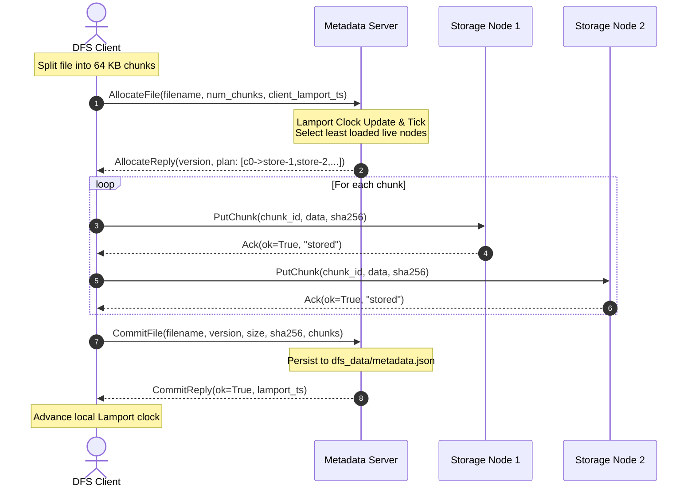
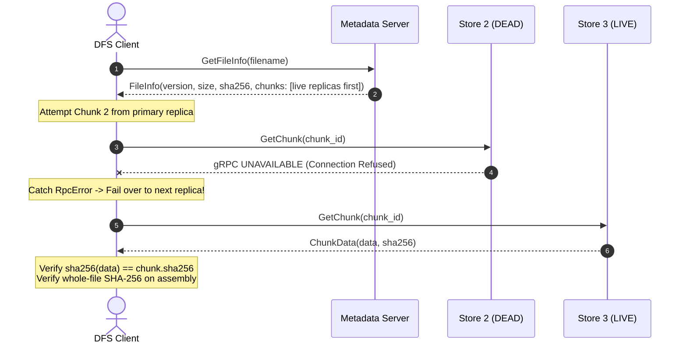
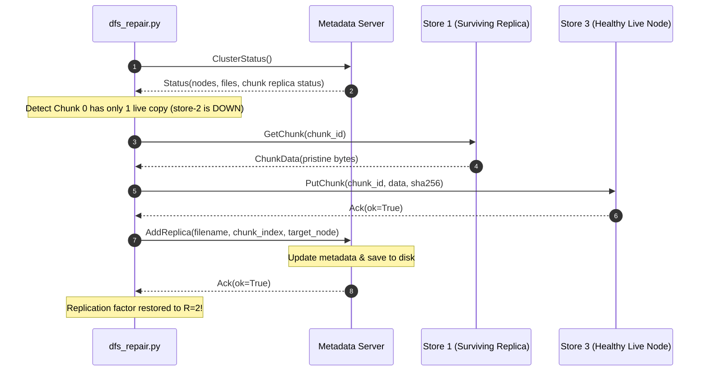

# 🏆 Distributed Computing (DC) Lab: Experiments 2 to 11 Comprehensive Guide

**Course**: Distributed Computing (Sem 7 - Computer Engineering)  
**Faculty In-Charge**: Prof. Dhanashree Tamhane  
**Mini-Project**: **ChessMate** (Distributed Multiplayer Chess Platform)  
**Technology Stack**: Python 3.10, gRPC, Protocol Buffers (proto3), Lamport Logical Clocks, Ricart-Agrawala Mutual Exclusion, Wait-For Graph Deadlock Detection, Least Connections Load Balancing, Gossip Replication & Last-Write-Wins (LWW), Redis Cache-Aside Fault Tolerance, Raft Consensus Leader Election & Failover, Kubernetes Container Orchestration, Headless Services, python-chess  

---

## 📑 Table of Contents
1. [Overview & Project Architecture](#-overview--project-architecture)
2. [Experiment 2: Develop RPC APIs Between Services (gRPC over HTTP/2)](#-experiment-2-develop-rpc-apis-between-services)
3. [Experiment 3: Lamport Logical Clock Synchronization](#-experiment-3-lamport-logical-clock-synchronization)
4. [Experiment 4: Ricart-Agrawala Mutual Exclusion over gRPC](#-experiment-4-ricart-agrawala-mutual-exclusion-over-grpc)
5. [Experiment 5: Simulate & Resolve Deadlocks via Wait-For Graph Cycle Detection](#-experiment-5-simulate--resolve-deadlocks-via-wait-for-graph)
6. [Experiment 6: Load Balancing Strategy (Least Connections)](#-experiment-6-load-balancing-strategy-least-connections)
7. [Experiment 7: Eventual Consistency (Gossip Replication + Last-Write-Wins)](#-experiment-7-eventual-consistency)
8. [Experiment 8: Redis Caching for Fault Tolerance (Cache-Aside Pattern)](#-experiment-8-redis-caching-for-fault-tolerance)
9. [Experiment 9: Raft Leader Election & Failover for Uninterrupted Coordination](#-experiment-9-raft-leader-election--failover)
10. [Experiment 10: Deploy a Complete System on Kubernetes & Simulate Load](#-experiment-10-deploy-on-kubernetes--simulate-load)
11. [Experiment 11: Distributed File System Storage (Chunking, Replication, Failover and Repair)](#11-experiment-11-distributed-file-system-chunking-replication-failover-and-repair)
12. [Master Viva Cheat-Sheet (Top 60 Questions & Answers)](#-master-viva-cheat-sheet-top-60-questions--answers)
13. [Quick Command Reference Guide](#-quick-command-reference-guide)

---

## 🏛️ Overview & Project Architecture

In modern distributed systems, standalone monolithic architectures are replaced by decoupled microservices that communicate over the network. Throughout Experiments 2 to 10, we have implemented the complete distributed computing hierarchy for our **ChessMate** platform:

```
┌─────────────────────────────────────────────────────────────────────────────┐
│                             CHESSMATE SYSTEM                                │
├─────────────────────────────────────────────────────────────────────────────┤
│  [Exp 2] Inter-Service RPC        : Client Node  <──gRPC/HTTP2──> Server Node│
│  [Exp 3] Event Synchronization   : Lamport Clock attached to every RPC msg  │
│  [Exp 4] Distributed Mutex        : P2P Ricart-Agrawala (No Central Server) │
│  [Exp 5] Concurrency & Deadlocks : Central WFG Cycle Detection & Resolution │
│  [Exp 6] Dynamic Load Balancing   : Least Connections Router (min active conn)│
│  [Exp 7] Eventual Consistency     : Gossip Replication + LWW (Lamport Clocks)│
│  [Exp 8] Fault-Tolerant Caching   : Cache-Aside (Dual-Key Fresh/Stale Redis) │
│  [Exp 9] Fault-Tolerant Consensus : Raft Leader Election & Failover (Quorum) │
│  [Exp 10] Cloud Orchestration     : Kubernetes Headless Pool & Load Job     │
│  [Exp 11] Distributed Storage     : Chunking, R=2 Replicas & Self-Healing   │
└─────────────────────────────────────────────────────────────────────────────┘
```

---

## ♟️ Experiment 2: Develop RPC APIs Between Services

### 1. Main Aim
> **To develop and implement Remote Procedure Call (RPC) APIs using gRPC for high-speed, strongly typed communication between distributed client and server microservices in the ChessMate project.**

### 2. Why Are We Doing This? (Motivation & Need)
* **Shortcomings of REST/JSON**: Traditional HTTP/1.1 REST APIs exchange plain-text JSON. In real-time multiplayer gaming like ChessMate, JSON parsing is computationally slow, payloads are bloated with string keys, and HTTP/1.1 suffers from Head-of-Line (HoL) blocking.
* **The RPC Paradigm**: Remote Procedure Call (RPC) allows a client program to execute a function on a remote machine with the exact same syntax as a local in-memory function call (`result = stub.MakeMove(...)`).
* **Why gRPC**: Developed by Google, gRPC operates on top of **HTTP/2** (multiplexing multiple parallel calls over a single TCP connection, header compression) and serializes structured data using binary **Protocol Buffers** (`proto3`), yielding 5x to 10x higher throughput and strict compile-time type safety.

### 3. What Is It Useful For in ChessMate?
* **Decoupling**: The **Chess Client Service** (player UI / frontend gateway) is physically separated from the compute-intensive **Chess Game Server** (board evaluator, move legality validator, room state manager).
* **Guaranteed Rule Enforcement**: Moves are validated server-side using the international rules of chess (`chess.Board`), preventing client tampering.

### 4. How We Have Done It (Technical Architecture)
1. **Defined the Interface Definition Language (IDL)** in [`proto/chess.proto`](proto/chess.proto):
   * `rpc CreateRoom (CreateRoomRequest) returns (CreateRoomResponse)`
   * `rpc MakeMove (MakeMoveRequest) returns (MakeMoveResponse)`
   * `rpc GetGameState (GetGameStateRequest) returns (GetGameStateResponse)`
2. **Compiled Protobuf Stubs**:
   ```bash
   python -m grpc_tools.protoc -I=proto --python_out=. --grpc_python_out=. proto/chess.proto
   ```
   Generates `chess_pb2.py` (message classes) and `chess_pb2_grpc.py` (client stubs & server servicer base classes).
3. **Implemented Server** ([`chess_server.py`](chess_server.py)):
   * Inherits from `chess_pb2_grpc.ChessServiceServicer`.
   * Manages in-memory chess rooms, handles moves, tracks turns (White vs Black), detects check/checkmate using `python-chess`.
   * Listens on TCP port `50051`.
4. **Implemented Client** ([`chess_client.py`](chess_client.py)):
   * Connects via `grpc.insecure_channel('localhost:50051')`.
   * Creates a room $\to$ plays White $e2 \to e4$ $\to$ plays Black $e7 \to e5$ $\to$ plays White $g1 \to f3$ $\to$ queries full game state.

### 5. How to Manually Run Experiment 2
* **Terminal 1 (Server)**:
  ```bash
  python chess_server.py
  ```
* **Terminal 2 (Client)**:
  ```bash
  python chess_client.py
  ```

### 6. Expected Output
* **Server**:
  ```text
  [SERVER] Initialized ChessMate Game State Manager
  Chess Service Started on Port 50051...
  [SERVER] [RPC: CreateRoom] Room Created: 'VIT-DC Championship Room' (Code: 402)
  [SERVER] [RPC: MakeMove] Room 402: WHITE played e4 -> Next turn: black
  [SERVER] [RPC: MakeMove] Room 402: BLACK played e5 -> Next turn: white
  [SERVER] [RPC: MakeMove] Room 402: WHITE played Nf3 -> Next turn: black
  [SERVER] [RPC: GetGameState] Room 402 state queried. Total moves: 3
  ```
* **Client**:
  ```text
  [STEP 1] Invoking RPC: CreateRoom()... -> Room Code: 402, Status: created
  [STEP 2] Invoking RPC: MakeMove() -> White e2 to e4 -> Valid: True, SAN: e4, Turn: black
  [STEP 3] Invoking RPC: MakeMove() -> Black e7 to e5 -> Valid: True, SAN: e5, Turn: white
  [STEP 4] Invoking RPC: MakeMove() -> White g1 to f3 -> Valid: True, SAN: Nf3, Turn: black
  [STEP 5] Invoking RPC: GetGameState() -> History: ['e4', 'e5', 'Nf3'], Board FEN retrieved
  ```

### 7. Key Viva Questions for Experiment 2
* **Q: What is RPC?**
  * *A*: A communication mechanism allowing a computer program to cause a subroutine to execute on another machine in a network without the programmer explicitly coding network details.
* **Q: Why is Protocol Buffers faster than JSON?**
  * *A*: Protobuf is a compact binary serialization format. Field names are mapped to numeric tags (1, 2, 3), stripping out verbose text keys. Numbers are stored using varints, and no textual whitespace or quotes are parsed.
* **Q: What features does HTTP/2 provide to gRPC?**
  * *A*: Binary framing, multiplexing (multiple bidirectional requests over one TCP socket), HPACK header compression, and native client/server streaming.
* **Q: What is the difference between a Stub and a Servicer?**
  * *A*: A **Stub** is the client-side proxy that marshals parameters and dispatches the call over the network. A **Servicer** is the server-side abstract interface that the programmer subclasses to provide real business logic.

---

## ⏰ Experiment 3: Lamport Logical Clock Synchronization

### 1. Main Aim
> **To implement Leslie Lamport's Logical Clock Synchronization algorithm to maintain consistent causal event ordering across distributed services without physical clock synchronization.**

### 2. Why Are We Doing This? (Motivation & Need)
* **The Physical Clock Problem**: In distributed computing, every physical machine has its own quartz crystal oscillator clock. Due to manufacturing variations and temperature, physical clocks experience **clock drift** (gradually gaining or losing time) and **clock skew** (difference in time between two clocks). Even NTP (Network Time Protocol) cannot eliminate millisecond uncertainty.
* **The Causality Problem**: If Player 1 creates a game room at physical time $t_1$, and Player 2 joins at physical time $t_2$, clock skew could cause $t_2 < t_1$, creating an impossible causality paradox where a move is played in a room that hasn't been created yet!
* **The Solution**: In 1978, Leslie Lamport proved that physical time doesn't matter for correctness; what matters is **causal order** ("Happened-Before" relationship $a \to b$).

### 3. What Is It Useful For in ChessMate?
* **Deterministic Event Ordering**: Guarantees that chess game room initialization strictly precedes Move 1, and Move 1 strictly precedes Move 2, regardless of clock drift on client or server hardware.
* **Auditability & Traceability**: Provides a reliable logical timeline for distributed game logs and anti-cheat replay verification.

### 4. How We Have Done It (Technical Architecture)
1. **Implemented Lamport Algorithm** in [`lamport_clock.py`](lamport_clock.py):
   * State variable: `self.time = 0`
   * **Rule 1 (Local / Send Event)**: Advance local clock by 1:
     $$L = L + 1$$
   * **Rule 2 (Receive Event)**: Upon message arrival with timestamp $L_{received}$, update:
     $$L = \max(L_{local}, L_{received}) + 1$$
2. **Updated Proto Definition** in [`proto/lamport_chess.proto`](proto/lamport_chess.proto):
   * Every request message embeds `int64 lamport_time`.
   * Every response message embeds `int64 lamport_time`.
3. **Synchronized Client & Server** ([`lamport_chess_client.py`](lamport_chess_client.py) & [`lamport_chess_server.py`](lamport_chess_server.py)):
   * **Client send `CreateRoom`**: Clock advances $0 \to$ **`1`**.
   * **Server receive & respond**: Clock updates $\max(0, 1) + 1 =$ **`2`**. Client receives $\to$ Clock is **`2`**.
   * **Client send `MakeMove (e2->e4)`**: Clock advances $2 \to$ **`3`**.
   * **Server receive & respond**: Clock updates $\max(2, 3) + 1 =$ **`4`**. Client receives $\to$ Clock is **`4`**.
   * **Client send `MakeMove (e7->e5)`**: Clock advances $4 \to$ **`5`**.
   * **Server receive & respond**: Clock updates $\max(4, 5) + 1 =$ **`6`**. Client receives $\to$ Clock is **`6`**.
   * **Client send `GetGameState`**: Clock advances $6 \to$ **`7`**.
   * **Server receive & respond**: Clock updates $\max(6, 7) + 1 =$ **`8`**. Client receives $\to$ Clock is **`8`**.

### 5. How to Manually Run Experiment 3
* **Terminal 1 (Server)**:
  ```bash
  python lamport_chess_server.py
  ```
* **Terminal 2 (Client)**:
  ```bash
  python lamport_chess_client.py
  ```

### 6. Expected Output
```text
========== CREATE ROOM ==========
Sending Request    | Lamport Clock : 1
Received Response  | Lamport Clock : 2 (Room Code: 839)

========== MAKE MOVE (WHITE: e2 to e4) ==========
Sending Request    | Lamport Clock : 3
Received Response  | Lamport Clock : 4 (Valid: True, Move: e4)

========== MAKE MOVE (BLACK: e7 to e5) ==========
Sending Request    | Lamport Clock : 5
Received Response  | Lamport Clock : 6 (Valid: True, Move: e5)

========== GET GAME STATE ==========
Sending Request    | Lamport Clock : 7
Received Response  | Lamport Clock : 8 (Moves: ['e4', 'e5'])
```

### 7. Key Viva Questions for Experiment 3
* **Q: What is the "Happened-Before" relationship ($a \to b$)?**
  * *A*: Defined by Lamport:
    1. If $a$ and $b$ occur in the same process and $a$ occurs before $b$, then $a \to b$.
    2. If $a$ is the sending of a message and $b$ is the receipt of that message, then $a \to b$.
    3. If $a \to b$ and $b \to c$, then $a \to c$ (transitivity).
* **Q: If $C(a) < C(b)$, did $a$ causally cause $b$? (TRICK QUESTION)**
  * *A*: **No!** If $a \to b$, then $C(a) < C(b)$ is guaranteed (Clock Condition). However, the converse is **not necessarily true**. If $C(a) < C(b)$, the two events could be independent / concurrent ($a \parallel b$). Lamport clocks define a **partial order**, not a causal history (which requires Vector Clocks).
* **Q: What is the difference between Lamport Clocks and Vector Clocks?**
  * *A*: Lamport clocks use a single scalar integer (cannot distinguish causal vs concurrent events). Vector clocks maintain an array of size $N$ (one integer per process), allowing an exact determination of whether $a \to b$ or $a \parallel b$.

---

## 🛡️ Experiment 4: Ricart-Agrawala Mutual Exclusion over gRPC

### 1. Main Aim
> **To implement peer-to-peer distributed mutual exclusion using the Ricart-Agrawala algorithm over gRPC, ensuring exclusive access to a shared resource without any central coordinator.**

### 2. Why Are We Doing This? (Motivation & Need)
* **Single Point of Failure (SPOF)**: A centralized coordinator managing locks will crash if the coordinator node goes down, halting the entire distributed system.
* **Why Ricart-Agrawala**: It is a completely decentralized, permission-based mutual exclusion algorithm. Every node acts as both a client and a server. It optimizes Lamport's original mutual exclusion algorithm, reducing message complexity from $3(N-1)$ to only **$2(N-1)$ messages** per critical section entry.

### 3. What Is It Useful For in ChessMate?
* **Tournament Slot Assignment / Leaderboard Broadcast**: Multiple decentralized tournament nodes compete to claim an exclusive **Tournament Championship Submission Slot**. Only one node can hold the slot at any instant.

### 4. How We Have Done It (Technical Architecture)
1. **Defined Proto Service** in [`proto/artwork.proto`](proto/artwork.proto) and [`proto/chess.proto`](proto/chess.proto):
   * `service MutexService { rpc RequestAccess (AccessRequest) returns (AccessReply); }`
   * `AccessRequest { int32 node_id; int32 timestamp; }`
2. **Three Node States** in [`node.py`](node.py):
   * `RELEASED`: Outside critical section (grants all incoming requests).
   * `WANTED`: Wants critical section; broadcasts requests to all peers.
   * `HELD`: Executing inside critical section (defers all incoming requests).
3. **The Core Algorithm Decision Logic (`RequestAccess`)**:
   A node **DEFERS** an incoming peer request if and only if:
   $$\text{State} == \text{"HELD"} \quad \text{OR} \quad (\text{State} == \text{"WANTED"} \ \land \ (T_{local}, ID_{local}) < (T_{req}, ID_{req}))$$
   Otherwise, it **GRANTS** immediately.
4. **The gRPC Blocking Handler Trick**:
   * Instead of sending an explicit separate reply message later, the server's RPC thread simply **blocks** on a `threading.Event().wait()`.
   * When the holding node exits the critical section (`release_cs()`), it invokes `event.set()`, which unblocks the handler and returns the response. The RPC response *is* the reply!
5. **Tie-Breaking Rule**:
   * If two nodes request access with identical timestamps ($T_1 == T_2$), tie-breaking is done using node ID: $(T_1, \text{ID}_1) < (T_2, \text{ID}_2)$. Smaller node ID wins priority.

### 5. How to Manually Run Experiment 4
#### Option A: Automated Multi-Process Runner (Recommended)
```bash
python run_exp4.py
```
#### Option B: Manual 3-Terminal Execution (Lab PDF Method)
Open 3 separate terminals in the project root and launch within 6 seconds of each other:
* **Terminal 1**: `python node.py 1` (port 60051)
* **Terminal 2**: `python node.py 2` (port 60052)
* **Terminal 3**: `python node.py 3` (port 60053)

### 6. Expected Output
```text
[Node-1] WANTS critical section (Timestamp: 1) -> Node-2 GRANTS, Node-3 GRANTS
[Node-1] >>> ENTERED CRITICAL SECTION <<<
[Node-2] WANTS critical section (Timestamp: 4) -> Node-1 DEFERS (Node-1 priority < Node-2)
[Node-3] WANTS critical section (Timestamp: 4) -> Node-1 DEFERS (Node-1 priority < Node-3)
[Node-1] RELEASED critical section. Unblocking 2 deferred peers...

--- Tie-Breaking Between Node-2 (4, 2) and Node-3 (4, 3) ---
[Node-2] DEFERS request from Node-3 [(4, 2) < (4, 3)]
[Node-2] >>> ENTERED CRITICAL SECTION <<<
[Node-2] RELEASED critical section. Unblocking Node-3...
[Node-3] >>> ENTERED CRITICAL SECTION <<<
[Node-3] RELEASED critical section.
```

### 7. Key Viva Questions for Experiment 4
* **Q: How many messages does Ricart-Agrawala require?**
  * *A*: $2(N - 1)$ messages per critical section execution ($N-1$ request messages sent, $N-1$ replies received).
* **Q: Why does Ricart-Agrawala need fewer messages than Lamport's algorithm?**
  * *A*: Lamport's algorithm requires $3(N-1)$ messages because it sends an explicit release message to all peers. Ricart-Agrawala suppresses the reply when a node wants the critical section and only sends the reply when it releases it, combining the reply and release steps.
* **Q: How do you prevent deadlocks in Ricart-Agrawala?**
  * *A*: Requests are totally ordered by $(timestamp, node\_id)$. Since timestamps strictly increase and node IDs are unique, no cycle of dependencies can ever form.

---

## 🔄 Experiment 5: Simulate & Resolve Deadlocks via Wait-For Graph

### 1. Main Aim
> **To simulate a circular wait deadlock caused by inverted shared lock acquisition, and implement an automated centralized Wait-For Graph (WFG) cycle detection algorithm to detect and resolve the deadlock.**

### 2. Why Are We Doing This? (Motivation & Need)
* **The Deadlock Dilemma**: When multiple concurrent processes acquire multiple resources in an inconsistent order, deadlocks can occur.
* **The 4 Coffman Conditions**:
  1. *Mutual Exclusion* (exclusive lock ownership).
  2. *Hold and Wait* (holding one lock while waiting for another).
  3. *No Preemption* (locks cannot be forcibly stripped).
  4. *Circular Wait* (Process A waits for B, Process B waits for A).
* **Why Detection & Recovery**: In complex distributed architectures, strictly enforcing lock ordering at compile-time is often impossible. Therefore, systems must dynamically detect cycles in their Wait-For Graph and resolve them by aborting and retrying.

### 3. What Is It Useful For in ChessMate?
* Resolving contention between two concurrent background services in ChessMate:
  * **AutoSave Service**: Locks `draft` (current board state) $\to$ then locks `submission` (leaderboard update).
  * **Final Submission Service**: Locks `submission` (match result) $\to$ then locks `draft` (current board state).
* Without cycle detection, both services freeze permanently.

### 4. How We Have Done It (Technical Architecture)
1. **Defined Proto Service** in [`proto/artwork.proto`](proto/artwork.proto) and [`proto/chess.proto`](proto/chess.proto):
   * `service LockService { rpc AcquireLock; rpc ReleaseLock; }`
2. **Central LockManager** ([`lock_manager.py`](lock_manager.py)):
   * Tracks `self.locks = {resource_id: owner_id}` and `self.wait_for = {holder_id: resource_id}`.
   * Runs DFS cycle detection (`_would_cycle`):
     ```python
     def _would_cycle(self, holder, resource):
         visited = set()
         current_resource = resource
         while True:
             owner = self.locks.get(current_resource)
             if owner is None or owner == holder:
                 return owner == holder
             if owner in visited: return False
             visited.add(owner)
             current_resource = self.wait_for.get(owner)
             if current_resource is None: return False
     ```
3. **Deadlock Resolution Policy**:
   * If `DETECT == True` and `_would_cycle()` returns True, LockManager returns:
     `LockReply(granted=False, message="deadlock-abort")`.
4. **Worker Recovery Strategy** ([`worker.py`](worker.py)):
   * Catches `deadlock-abort`.
   * Immediately releases its held lock (breaking the *Hold and Wait* condition).
   * Backs off for 1.0 second (breaking the *Circular Wait*).
   * Retries acquiring both locks once the competing worker has completed.

### 5. How to Manually Run Experiment 5
#### Mode 1: Automated All-in-One Runner
```bash
python run_exp5.py          # Runs both Run 1 and Run 2 sequentially
python run_exp5.py sim      # Run 1 only (Simulation)
python run_exp5.py detect   # Run 2 only (Detection & Resolution)
```

#### Mode 2: Manual 3-Terminal Execution (Lab PDF Method)
##### Run 1 — Deadlock Simulation (Proving the Hang)
* **Terminal 1**: `python lock_manager.py` (Deadlock detection = False)
* **Terminal 2**: `python worker.py 1 autosave`
* **Terminal 3**: `python worker.py 2 submission`
*(Hit enter on Terminal 2 and 3 within 1s. Both will hang waiting for each other. Press Ctrl+C).*

##### Run 2 — Detect and Resolve Deadlock
* **Terminal 1**: `python lock_manager.py detect` (Deadlock detection = True)
* **Terminal 2**: `python worker.py 1 autosave`
* **Terminal 3**: `python worker.py 2 submission`
*(Observe: LockManager aborts Node-2 $\to$ Node-2 releases lock & retries $\to$ Node-1 finishes $\to$ Node-2 finishes $\to$ Both print `DONE`!)*

### 6. Expected Output (Run 2: Detection)
```text
[LockManager] Node-1 ACQUIRED 'draft'
[LockManager] Node-2 ACQUIRED 'submission'
[LockManager] Node-1 WAITING for 'submission' (held by Node-2)
[LockManager] DEADLOCK DETECTED: Node-2 -> 'draft' (held by Node-1) would close a cycle. Aborting Node-2.
[Worker-2] Node-2: 'draft' -> granted=False (deadlock-abort)
[Worker-2] Node-2: ABORTED -- releasing held locks and retrying
[LockManager] Node-2 RELEASED 'submission'
[LockManager] Node-1 ACQUIRED 'submission' (after wait)
[Worker-1] Node-1: DONE
[LockManager] Node-2 ACQUIRED 'draft' & 'submission'
[Worker-2] Node-2: DONE
```

### 7. Key Viva Questions for Experiment 5
* **Q: What is a Wait-For Graph (WFG)?**
  * *A*: A directed graph used for deadlock detection where vertices represent processes, and a directed edge $P_i \to P_j$ indicates that process $P_i$ is waiting for a resource currently held by process $P_j$. A directed cycle in a single-unit resource WFG indicates a deadlock.
* **Q: What is a "Phantom Deadlock"?**
  * *A*: A false deadlock detected in a distributed system due to message transmission delays. A detector may receive an outdated message stating a process is waiting, even though the process has already released the resource.
* **Q: Why use a Centralized Lock Manager for Deadlock Detection rather than decentralized?**
  * *A*: Cycle detection requires an instantaneous, global snapshot of who is holding what. Centralized detection avoids message coordination overhead and eliminates phantom deadlocks.
* **Q: How does our implementation prevent starvation after a deadlock abort?**
  * *A*: The aborted worker releases its held lock and executes a randomized backoff sleep (`time.sleep(1)`). This allows the other worker sufficient time to complete and release its resources before the aborted worker retries.

---

## ⚖️ Experiment 6: Load Balancing Strategy (Least Connections)

### 1. Main Aim
> **To implement a dynamic Load Balancer in front of $N$ identical backend services using the Least Connections strategy, routing each incoming request to the server with the fewest active in-flight connections.**

### 2. Why Are We Doing This? (Motivation & Need)
* **Shortcomings of Round Robin**: Round Robin assigns requests in a rigid sequential rotation ($A \to B \to C \to A \dots$) under the false assumption that every request takes identical processing time.
* **The Reality of Variable Workloads**: In distributed systems, requests have wildly fluctuating processing latencies (e.g. lightweight cache hits vs compute-heavy evaluations). Round Robin blindly stacks slow requests onto an already saturated node while other nodes sit idle.
* **Why Least Connections**: Least Connections makes routing decisions fresh for each request based on real-time system state, always forwarding to the backend with minimum currently active connections.

### 3. What Is It Useful For in ChessMate?
* **Distributed Chess Engine Worker Pool**: Chess move evaluation and Stockfish depth searches take drastically different times depending on board complexity (0.5s to 2.5s). A Least Connections load balancer ensures that heavy tactical positions do not monopolize a single engine worker while others remain underutilized.

### 4. How We Have Done It (Technical Architecture)
1. **Defined Proto Contract** in [`proto/service.proto`](proto/service.proto):
   * `service WorkerService { rpc HandleRequest (WorkRequest) returns (WorkReply); }`
2. **Backend Worker Server** ([`worker_server.py`](worker_server.py)):
   * Instantiates `WorkerServicer(name)` on ports `60201`, `60202`, `60203`.
   * Simulates variable-duration workloads using `time.sleep(random.uniform(0.5, 2.5))`.
3. **Core Load Balancer Algorithm** ([`load_balancer.py`](load_balancer.py)):
   * Tracks `active = [0, 0, 0]` protected by `threading.Lock()`.
   * **`pick_least_connections()`**:
     ```python
     with lock:
         idx = active.index(min(active))
         active[idx] += 1
         return idx
     ```
   * **`release(idx)`**: In a `finally:` block, decrements `active[idx]` so in-flight counters are always reclaimed even if an RPC fails.
4. **Automated Multi-Process Orchestrator** ([`run_exp6.py`](run_exp6.py)):
   * Concurrently launches 3 backend servers, verifies listener readiness, dispatches staggered requests, validates final counters return to `[0, 0, 0]`, and terminates workers.

### 5. How to Manually Run Experiment 6
#### Option A: Automated Multi-Process Runner (Recommended)
```bash
python run_exp6.py
```
#### Option B: Manual 4-Terminal Execution (Lab PDF Method)
* **Terminal 1**: `python worker_server.py 60201`
* **Terminal 2**: `python worker_server.py 60202`
* **Terminal 3**: `python worker_server.py 60203`
* **Terminal 4**: `python load_balancer.py`

### 6. Expected Output
```text
[LB] Load Balancer starting. Backends: ['localhost:60201', 'localhost:60202', 'localhost:60203']
[LB] Routing -> localhost:60201 (active connections now: [1, 0, 0])
[LB] Routing -> localhost:60202 (active connections now: [1, 1, 0])
[LB] Routing -> localhost:60203 (active connections now: [1, 1, 1])
[LB] Routing -> localhost:60201 (active connections now: [2, 1, 1])
...
[LB] Released localhost:60203 (active connections now: [0, 0, 0])
[LB] All requests processed.
[LB] Final active connection counts (should all be 0): [0, 0, 0]
```

### 7. Key Viva Questions for Experiment 6
* **Q: What is the main difference between Round Robin and Least Connections?**
  * *A*: Round Robin routes requests in a static cyclic order regardless of server load. Least Connections inspects real-time in-flight connection counts and routes to the node with the fewest active jobs.
* **Q: When does Least Connections outperform Round Robin?**
  * *A*: When request processing times vary significantly (heterogeneous workloads). Round Robin causes queue hotspots, whereas Least Connections naturally steers new traffic away from slow/busy workers.
* **Q: Why must `active[idx] += 1` occur inside the mutex before dispatching the request?**
  * *A*: If the counter is incremented after dispatch or outside the lock, concurrent request threads can read stale minimums and route multiple requests to the same backend simultaneously (race condition).
* **Q: Why must `active[idx] -= 1` be executed inside a `finally` block?**
  * *A*: To guarantee that the connection counter is always decremented even if network timeouts, socket disconnects, or exceptions occur during RPC handling.

---

## 🌐 Experiment 7: Eventual Consistency (Gossip Replication + Last-Write-Wins)

### 1. Main Aim
> **To implement a geo-replicated data store using Gossip Replication and resolve concurrent conflicting writes deterministically via Last-Write-Wins (LWW) with Lamport timestamps, proving eventual consistency across replicas.**

### 2. Why Are We Doing This? (Motivation & Need)
* **CAP Theorem Trade-Off**: In distributed data systems, Strong Consistency requires all replicas to coordinate and agree before a write can be acknowledged. Under network partitions or high latency, this degrades availability and increases client latency.
* **Why Eventual Consistency**: Systems like Amazon DynamoDB, Apache Cassandra, and real-time gaming backends trade instantaneous consistency for high availability and low latency. Writes are accepted locally and acknowledged immediately to the client, then propagated asynchronously in the background via gossip protocol.
* **Conflict Resolution via Last-Write-Wins (LWW)**: When two clients concurrently write different values for the same key to different replicas, replicas will temporarily disagree (inconsistency window). To guarantee convergence without human intervention, each update carries a logical Lamport timestamp and origin node ID. The update with the higher tuple `(lamport_timestamp, origin_replica)` strictly wins.

### 3. What Is It Useful For in ChessMate?
* **Geo-Distributed Player Profiles & Active Match Metadata**: Players around the world connect to their nearest edge region (e.g. Region A: US-East, Region B: EU-Central, Region C: AP-South). Player bio updates, match room tags, and presence indicators are acknowledged instantaneously at the edge and gossiped asynchronously. Conflicting profile updates converge globally to the logically latest update without locking global databases.

### 4. How We Have Done It (Technical Architecture)
1. **Defined Proto Contract** in [`proto/replica.proto`](proto/replica.proto):
   * `SaveValue (ValueUpdate) returns (SaveAck)` — Client to replica local write.
   * `SyncUpdate (ValueUpdate) returns (SaveAck)` — Replica to replica asynchronous gossip.
   * `GetValue (ValueQuery) returns (ValueState)` — Reads replica's local state.
2. **Accept-then-Gossip Replica Node** ([`replica_node.py`](replica_node.py)):
   * Replicas `A` (port 60301), `B` (port 60302), and `C` (port 60303).
   * **Accept-then-Gossip Pattern**: Applies write to local in-memory store immediately, responds to the client, and launches a background daemon thread to gossip the update to all peers.
   * **Last-Write-Wins (LWW) Logic**:
     ```python
     if current is None or (ts, origin) > (current[1], current[2]):
         self.store[key] = (content, ts, origin)  # APPLIED
         return True
     else:
         # IGNORED stale update
         return False
     ```
   * **Lamport Clock Synchronization**: On send/write: `clock += 1`. On gossip receive: `clock = max(clock, received_ts) + 1`.
3. **Concurrent Conflict Test Client** ([`replica_client.py`](replica_client.py)):
   * Spawns two concurrent writer threads hitting different replicas for `shared-key-1` nearly simultaneously:
     - Writer 1 writes `"value-from-writer-1"` to Replica A.
     - Writer 2 writes `"value-from-writer-2"` to Replica C.
   * Reads immediately to demonstrate the **inconsistency window** (temporary disagreement).
   * Sleeps 2 seconds to allow gossip propagation.
   * Reads again to verify **eventual consistency convergence** on all replicas.
4. **Automated Multi-Process Orchestrator** ([`run_exp7.py`](run_exp7.py)):
   * Launches all 3 replicas, waits for sockets, runs the client test, captures replica APPLIED/IGNORED logs, and shuts down cleanly.

### 5. How to Manually Run Experiment 7
#### Option A: Automated Multi-Process Runner (Recommended)
```bash
python run_exp7.py
```
#### Option B: Manual 4-Terminal Execution (Lab PDF Method)
* **Terminal 1**: `python replica_node.py A 60301`
* **Terminal 2**: `python replica_node.py B 60302`
* **Terminal 3**: `python replica_node.py C 60303`
* **Terminal 4**: `python replica_client.py`

### 6. Expected Output
```text
=== Simulating two concurrent writers hitting DIFFERENT replicas ===
[Client] Saved on Replica-C: "value-from-writer-2" -> accepted=True, replica_ts=1
[Client] Saved on Replica-A: "value-from-writer-1" -> accepted=True, replica_ts=1

=== Immediately after writes (replicas may still be mid-gossip) ===
Replica-A: "value-from-writer-1" (ts=1, origin=A)
Replica-B: "" (ts=0, origin=)
Replica-C: "value-from-writer-2" (ts=1, origin=C)

Waiting 2s for gossip to finish propagating...

=== After convergence window ===
Replica-A: "value-from-writer-2"
Replica-B: "value-from-writer-2"
Replica-C: "value-from-writer-2"

*** CONVERGED: all replicas agree on: "value-from-writer-2" ***
```

### 7. Key Viva Questions for Experiment 7
* **Q: What is Eventual Consistency?**
  * *A*: A consistency model which guarantees that, if no new updates are made, all replicas will eventually return the same value after background updates propagate.
* **Q: What is the "Accept-then-Gossip" pattern?**
  * *A*: A replica applies a client write to its local store and responds with success immediately before replicating in the background, maximizing write availability and responsiveness.
* **Q: How does Last-Write-Wins (LWW) resolve concurrent write conflicts?**
  * *A*: It orders writes by Lamport timestamp. If timestamps are equal, it uses the replica identifier as a deterministic tie-breaker `(timestamp, origin_replica)`, ensuring all nodes select the exact same winning write.
* **Q: What is the "Inconsistency Window"?**
  * *A*: The duration of time between a local write and the completion of gossip propagation across all peer replicas during which concurrent readers may observe different values.
* **Q: Why is fire-and-forget background gossiping preferred over synchronous replication in this model?**
  * *A*: Synchronous replication blocks until all nodes acknowledge, making the write fail or hang if any single node is slow or partitioned (violating availability). Background gossiping ensures fault-tolerant, high-throughput writes.

---

## 8. Experiment 8: Redis Caching for Fault Tolerance (Cache-Aside Pattern)

### 1. Aim
To design, implement, and evaluate a resilient **Cache-Aside (Lazy Loading)** caching architecture using Redis in front of an existing gRPC backend service, guaranteeing rapid read latency and graceful fault tolerance under independent failures of either the caching tier or the backend database service.

### 2. Motivation & Significance
In distributed architectures, directly querying backend databases or primary microservices for every read request creates severe bottlenecks, elevates latency, and renders the client vulnerable to cascading failures when the backend crashes.
A **Cache-Aside Gateway** with dual-key resilience addresses both performance and availability:
* **Latency Reduction**: Repeated reads are returned directly from in-memory Redis in sub-millisecond time (`cache-hit`), completely bypassing the backend server.
* **Cache Outage Resilience**: If Redis goes down, the gateway gracefully falls back to the backend service without failing the client request (`backend`).
* **Backend Outage Resilience**: If the backend database/service crashes, the gateway retrieves and serves a previously cached value from an indefinite fallback key (`stale-fallback`), providing graceful degradation instead of throwing fatal errors.

### 3. ChessMate System Integration
In our **ChessMate** multiplayer platform:
* The gRPC backend service is our existing [`server.py`](server.py) (reusing [`chess_server.py`](chess_server.py) from Experiment 2 on port 50051) with **zero modifications to backend business logic**.
* The Cache Gateway ([`cache_gateway.py`](cache_gateway.py)) intercepts client requests to inspect or fetch room/game status (`GetRoomState`).
* Frequently queried active rooms (such as spectated grandmaster games, tournament leaderboards, or live board positions) are served directly from Redis memory.
* When the game server restarts or encounters transient network disconnects, spectators and active players continue viewing the latest known board state and move history from the stale cache rather than receiving connection dropped errors.

### 4. Technical Architecture & Cache-Aside Mechanics
```
                      +-----------------------------+
                      |       Client Request        |
                      +--------------+--------------+
                                     |
                                     v
                      +-----------------------------+
                      |   Cache Gateway (Exp 8)     |
                      |     (cache_gateway.py)      |
                      +-------+--------------+------+
                              |              |
           [1. Try Fresh Key] |              | [3. Backend Outage Fallback]
                              v              v
               +------------------------------------+
               |           Redis Cache              |
               |   - fresh:item:{id} (TTL=10s)      |
               |   - stale:item:{id} (Indefinite)   |
               +------------------------------------+
                              |
           [2. Cache Miss / Redis Down Fallback]
                              v
               +------------------------------------+
               |      Existing gRPC Backend         |
               |     (server.py on port 50051)      |
               +------------------------------------+
```

#### Dual-Key Resilience Strategy
1. **`fresh:item:{id}`** (Short TTL = 10s): Normal cache entry. Automatically expires after 10 seconds to ensure clients observe fresh data as games evolve.
2. **`stale:item:{id}`** (No Expiry): Fallback-of-last-resort. Kept indefinitely and rewritten on every successful backend fetch. Never expires, ensuring that if the backend service crashes hours later, a valid fallback state is still retrievable.

#### Request Resolution Flow (`get_item(item_id)` in [`cache_gateway.py`](cache_gateway.py)):
1. **Try Cache First**:
   - Query Redis for `fresh:item:{item_id}` with a fail-fast timeout (`socket_connect_timeout=1`, `socket_timeout=1`).
   - If present: log `[Gateway] CACHE HIT` and return immediately (`cache-hit`).
2. **Cache Miss or Redis Unavailable**:
   - If key expired or `redis.exceptions.RedisError` caught: catch exception, fall back to backend.
   - Call `fetch_from_backend(item_id)` over gRPC channel (`timeout=2`).
   - If backend succeeds: log `[Gateway] Fetched item from BACKEND`, populate both `fresh:item:` (TTL=10s) and `stale:item:` (indefinite) in Redis, and return (`backend`).
3. **Backend Unavailable (Crash or Partition)**:
   - If `grpc.RpcError` caught: log `[Gateway] BACKEND UNAVAILABLE -- checking for stale cache`.
   - Query Redis for `stale:item:{item_id}`.
   - If present: log `[Gateway] Serving STALE cached copy` and return (`stale-fallback`).
   - If both backend and cache fail: raise `RuntimeError("Item unavailable: both backend and cache failed")`.

### 5. How to Manually Run Experiment 8
#### Option A: Automated Multi-Process Runner (Recommended)
An automated orchestrator executes all 4 stages (cache miss, cache hit, Redis outage, and backend outage) seamlessly:
```bash
python run_exp8.py
```

#### Option B: Manual Multi-Terminal Execution (Lab PDF Method)
* **Terminal 1 (Redis Server)**:
  ```bash
  python redis_server.py 6379
  # (Or native Redis daemon: redis-server / brew services start redis)
  ```
* **Terminal 2 (gRPC Backend)**:
  ```bash
  python server.py
  ```
* **Terminal 3 (Exercise Gateway Client)**:
  ```bash
  # Call 1: Cache Miss (fetches from backend)
  python cache_gateway.py 1

  # Call 2 (immediate): Cache Hit (served from Redis)
  python cache_gateway.py 1
  ```
* **Fault-Tolerance Test 1 (Redis Down)**:
  - Stop Redis (Ctrl+C in Terminal 1).
  - Run `python cache_gateway.py 1` in Terminal 3.
  - Notice `REDIS UNAVAILABLE` logged; request successfully served directly from backend.
* **Fault-Tolerance Test 2 (Backend Down)**:
  - Restart Redis in Terminal 1: `python redis_server.py 6379`.
  - Refresh cache in Terminal 3: `python cache_gateway.py 1`.
  - Kill gRPC Backend (Ctrl+C in Terminal 2).
  - Run `python cache_gateway.py 1` in Terminal 3.
  - Notice `BACKEND UNAVAILABLE` logged; request gracefully served from stale cached copy (`stale-fallback`).

### 6. Expected Output
```text
======================================================================
STAGE 1: Normal First Call (Cache Miss -> Fetches from Backend)
======================================================================
[Gateway] CACHE MISS for item 1 -- querying backend
[Gateway] Fetched item 1 from BACKEND

Result (source=backend): {'item_id': 1, 'data': 'Active Room 1: fen=rnbqkbnr/pppppppp/8/8/8/8/PPPPPPPP/RNBQKBNR w KQkq - 0 1, status=WAITING'}

======================================================================
STAGE 2: Immediate Second Call (Cache Hit -> Served from Redis)
======================================================================
[Gateway] CACHE HIT for item 1

Result (source=cache-hit): {'item_id': 1, 'data': 'Active Room 1: fen=rnbqkbnr/pppppppp/8/8/8/8/PPPPPPPP/RNBQKBNR w KQkq - 0 1, status=WAITING'}

======================================================================
STAGE 3: Fault-Tolerance Path 1 (Redis DOWN -> Falls Back to Backend)
======================================================================
[Gateway] REDIS UNAVAILABLE (Connection refused) -- falling back to backend directly
[Gateway] Fetched item 1 from BACKEND

Result (source=backend): {'item_id': 1, 'data': 'Active Room 1: fen=rnbqkbnr/pppppppp/8/8/8/8/PPPPPPPP/RNBQKBNR w KQkq - 0 1, status=WAITING'}

======================================================================
STAGE 4: Fault-Tolerance Path 2 (Backend DOWN -> Falls Back to Stale Cache)
======================================================================
[Gateway] CACHE MISS for item 1 -- querying backend
[Gateway] BACKEND UNAVAILABLE (StatusCode.UNAVAILABLE) -- checking for stale cache
[Gateway] Serving STALE cached copy for item 1

Result (source=stale-fallback): {'item_id': 1, 'data': 'Active Room 1: fen=rnbqkbnr/pppppppp/8/8/8/8/PPPPPPPP/RNBQKBNR w KQkq - 0 1, status=WAITING'}
```

### 7. Key Viva Questions for Experiment 8
* **Q: What is the Cache-Aside pattern?**
  * *A*: An application-level caching pattern where the application code explicitly checks the cache on reads, queries the database on a cache miss, and writes the fetched result into the cache before returning.
* **Q: Why do we maintain two distinct keys (`fresh:item:` and `stale:item:`)?**
  * *A*: The fresh key has a short TTL (10s) to reflect updates quickly. The stale key has no expiration, ensuring that if the backend service crashes after the fresh key has expired, the gateway can still serve a fallback copy rather than an outage error.
* **Q: Why should Redis calls have short socket connect and read timeouts?**
  * *A*: To ensure "fail-fast" behavior. If Redis is down or unreachable, long network timeouts would stall client requests. Setting a 1-second timeout allows immediate fallback to the database.
* **Q: How does Cache-Aside differ from Read-Through caching?**
  * *A*: In Cache-Aside, the application code orchestrates cache reads, misses, and DB queries. In Read-Through, the application only queries the cache store, and the cache store itself loads missing data from the database.
* **Q: What is a Cache Stampede (or Thundering Herd)?**
  * *A*: When a popular cache key expires, thousands of concurrent read requests simultaneously experience a cache miss and query the backend database, overwhelming it. Mitigations include mutex locking or probabilistic early recomputation (XFetch).

---

## 9. Experiment 9: Raft Leader Election & Failover for Uninterrupted Coordination

### 1. Aim
To design, implement, and evaluate a resilient **Raft-Based Distributed Consensus** cluster providing high-availability leader election, randomized heartbeat timeouts, and automatic failover, while gating centralized coordination operations (such as distributed lock grants and tournament coordination) behind the active elected leader.

### 2. Motivation & Single Point of Failure (SPOF)
In earlier experiments (such as Experiment 5's centralized Lock Manager or Experiment 6's Load Balancer), coordination relies on a single "coordinator" process. If that single coordinator process dies or loses network connectivity, the entire coordination capability collapses—no locks can be granted, no tournaments can be scheduled, and workers block indefinitely.
The **Raft Consensus Protocol** solves this fundamental limitation:
* **High Availability**: Coordination logic runs as a replicated cluster (e.g., 3 nodes: A, B, C).
* **Guaranteed Leadership**: Exactly one replica is elected as the active "Leader", while the others act as passive "Followers".
* **Automatic Failover**: When the active leader crashes, surviving followers detect the absence of periodic heartbeats within a randomized election window (1.5s–3.0s), trigger a new election term, and elect a new leader using majority quorum ($N//2 + 1$). Coordination recovers automatically without human intervention.

### 3. ChessMate System Integration
In our **ChessMate** multiplayer platform:
* Multiple chess tournaments and championship slots require exclusive distributed locks to prevent split-bracket corruption or conflicting autosaves.
* Instead of running an isolated `lock_manager.py` that can crash, we deploy a **3-node Raft consensus cluster** ([`raft_node.py`](raft_node.py) on ports 60401, 60402, 60403).
* Replicas expose both `RaftService` (for cluster consensus) and `LockService` (for client coordination) on the same gRPC server port.
* **Leadership Gating**: Follower replicas strictly refuse client lock requests with `not-leader,try=<leader_id>`, redirecting players/workers to the active leader.
* **Transparent Failover**: If the active leader server hosting Node-C suffers a hardware failure, Node-B detects missed heartbeats, wins election at Term 2, and seamlessly assumes lock granting duties.

### 4. Technical Architecture & Raft Mechanics
```
   +-------------------------------------------------------------------------+
   |                       ChessMate Client / Workers                        |
   +--------------------+--------------------------------+-------------------+
                        |                                |
        [Follower Query | Refused]       [Leader Query | Granted]
                        v                                v
         +-----------------------------+  Heartbeat (0.5s)  +---------------+
         |    RaftNode-A (Follower)    |<==================>|  RaftNode-C   |
         |         Port: 60401         |                    |   (LEADER)    |
         +-----------------------------+                    |  Port: 60403  |
                        ^                                   +---------------+
                        | Heartbeat (0.5s)                          ^
                        v                                           |
         +-----------------------------+                            |
         |    RaftNode-B (Follower)    |<===========================+
         |         Port: 60402         |
         +-----------------------------+
```

#### Core Components
1. **Node Lifecycle States**:
   * **`FOLLOWER`** (Default): Passively listens for heartbeats from the current leader and resets its election countdown timer.
   * **`CANDIDATE`**: When election countdown expires, increments term ($T \gets T + 1$), votes for itself, and broadcasts `RequestVote` RPCs to all peers.
   * **`LEADER`**: If candidate collects a strict majority quorum of votes ($votes > N // 2$), it transitions to `LEADER` and begins broadcasting `AppendEntries` heartbeats every 0.5s to maintain dominance.
2. **Randomized Election Timeouts (`(1.5s, 3.0s)`)**:
   * If all nodes used an identical timeout, they would transition to `CANDIDATE` simultaneously and split the votes (e.g. 1 vote each), causing perpetual election deadlocks.
   * A randomized interval guarantees that one node almost always times out first, acquiring a head start to gather majority votes.
3. **Monotonic Term Counters (`term`)**:
   * Terms act as logical time to detect obsolete leaders. A stale leader recovering from a network partition with an old term is immediately demoted to `FOLLOWER` upon observing a higher term in any incoming RPC.
4. **Quorum Majority Rule ($N//2 + 1$)**:
   * A 3-node cluster requires $3//2 + 1 = 2$ votes. It can tolerate $1$ node failure and still achieve consensus. A 5-node cluster requires $3$ votes and tolerates $2$ failures.
5. **Gated Coordination (`AcquireLock` / `ReleaseLock`)**:
   * Replicas implement `chess_pb2_grpc.LockServiceServicer`.
   * If `self.state != "LEADER"`, request is rejected with `granted=False, message="not-leader,try={leader_id}"`.
   * Only the active `LEADER` mutates distributed lock state.

### 5. How to Manually Run Experiment 9
#### Option A: Automated Multi-Process Runner (Recommended)
An automated orchestrator starts all 3 replicas, waits for initial election, tests follower refusal, tests leader grant, kills the active leader, verifies Term 2 failover, and confirms post-failover lock acquisition:
```bash
python run_exp9.py
```

#### Option B: Manual Multi-Terminal Execution (Lab PDF Method)
* **Terminal 1 (Replica A)**:
  ```bash
  python raft_node.py A
  ```
* **Terminal 2 (Replica B)**:
  ```bash
  python raft_node.py B
  ```
* **Terminal 3 (Replica C)**:
  ```bash
  python raft_node.py C
  ```
* **Terminal 4 (Exercise Gated Coordination Client)**:
  ```bash
  # Query Follower (Notice refusal and redirect hint to current leader):
  python raft_client.py A championship_slot 1

  # Query Leader directly (Notice lock is granted):
  python raft_client.py C championship_slot 1

  # Failover Test: Kill Terminal 3 (Leader) with Ctrl+C
  # Watch Terminal 1 & 2 detect missing heartbeats and elect a new leader!
  # Query the surviving new leader:
  python raft_client.py B championship_slot 2
  ```

### 6. Expected Output
```text
===========================================================================
DISTRIBUTED COMPUTING LAB - EXPERIMENT 9: RAFT LEADER ELECTION & FAILOVER
Consensus-Based Fault Tolerance for Uninterrupted Coordination
===========================================================================

[SETUP] Starting 3 Raft Replicas (Node A, Node B, Node C)...
  [Node-B] RaftNode-B listening on 127.0.0.1:60402 (port 60402)
  [Node-A] RaftNode-A listening on 127.0.0.1:60401 (port 60401)
  [Node-C] RaftNode-C listening on 127.0.0.1:60403 (port 60403)
[SETUP] All 3 Replicas online and listening.

---------------------------------------------------------------------------
STAGE 1: Observing Initial Leader Election (Term 1)
---------------------------------------------------------------------------
Waiting 4 seconds for election watchdog timeout and vote convergence...
  [Node-C] [C term=1 CANDIDATE] Starting election
  [Node-A] [A term=1 FOLLOWER] Voted for C (term 1)
  [Node-B] [B term=1 FOLLOWER] Voted for C (term 1)
  [Node-C] [C term=1 LEADER] *** ELECTED LEADER *** (3/3 votes)

[ELECTION VERIFIED] Initial Leader: Node-C (Followers: ['A', 'B'])

---------------------------------------------------------------------------
STAGE 2: Gated Coordination (Lock Service) Verification
---------------------------------------------------------------------------

[TEST 2A] Querying Follower Node-A for lock acquisition...
  Result: granted=False, message='not-leader,try=C'
  -> SUCCESS: Follower correctly refused request and redirected to leader (C)

[TEST 2B] Querying Active Leader Node-C for lock acquisition...
  [Node-C] [C term=1 LEADER] Granted lock on 'tournament_board_1' to worker 42
  Result: granted=True, message='granted by leader C'
  -> SUCCESS: Active Leader accepted and granted lock.

---------------------------------------------------------------------------
STAGE 3: Failover Test -- Killing Current Leader (Node-C)
---------------------------------------------------------------------------
[ACTION] Terminating Leader Node-C process (simulating server crash)...
[ACTION] Node-C is DOWN. Surviving replicas: ['A', 'B']

[ACTION] Surviving replicas will detect missing heartbeats (timeout 1.5s - 3.0s)...
  [Node-B] [B term=2 CANDIDATE] Starting election
  [Node-A] [A term=2 FOLLOWER] Voted for B (term 2)
  [Node-B] [B term=2 CANDIDATE] No response from C (may be down)
  [Node-B] [B term=2 LEADER] *** ELECTED LEADER *** (2/3 votes)

[FAILOVER VERIFIED] New Leader Elected: Node-B!
Current Cluster Topology: Leader=Node-B, Follower=Node-A, Dead=Node-C

---------------------------------------------------------------------------
STAGE 4: Post-Failover Gated Coordination via New Leader (Node-B)
---------------------------------------------------------------------------
[TEST 4] Requesting new lock 'tournament_board_2' from newly elected Leader Node-B...
  [Node-B] [B term=2 LEADER] Granted lock on 'tournament_board_2' to worker 99
  Result: granted=True, message='granted by leader B'
  -> SUCCESS: Coordination continued seamlessly without manual intervention!

===========================================================================
Experiment 9 execution completed successfully!
Raft consensus leader election, failover, and gated coordination verified.
===========================================================================
```

### 7. Key Viva Questions for Experiment 9
* **Q: What is the primary problem Raft solves in distributed systems?**
  * *A*: Eliminates Single Points of Failure (SPOF) in centralized coordinators by electing a single active leader among replicas that automatically fails over if the leader crashes.
* **Q: Why must Raft election timeouts be randomized (e.g., 1.5s–3.0s)?**
  * *A*: To prevent "split votes". If all nodes timed out simultaneously, they would all become candidates and vote for themselves, preventing anyone from acquiring a majority quorum.
* **Q: Why does Raft require a majority quorum ($N//2 + 1$) rather than unanimity?**
  * *A*: Unanimity would mean that if even one node fails or slows down, the cluster cannot make decisions. Quorum allows a cluster of $N$ nodes to tolerate up to $\lfloor(N-1)/2\rfloor$ failures.
* **Q: What is Split-Brain, and how does Raft prevent it?**
  * *A*: Split-Brain occurs when network partitions divide a cluster into two halves that both elect leaders. Raft prevents this because a candidate must receive a strict majority ($> N/2$); two disjoint partitions cannot both hold a majority simultaneously.
* **Q: What is "Gated Coordination"?**
  * *A*: Gating means coordination RPCs (like acquiring locks or assigning tasks) check the node's Raft state first. If the node is not `LEADER`, it rejects the request and returns a redirect hint to the current leader.

---

## 10. Experiment 10: Deploy a Complete System on Kubernetes & Simulate Load

### 1. Aim
To package the ChessMate distributed gRPC microservices into container images, deploy them as a self-healing multi-service cluster on Kubernetes, solve the HTTP/2 "gRPC single-connection load balancing trap" using Headless Services (`clusterIP: None`), demonstrate automatic pod failover and self-healing, and execute concurrent burst traffic simulation via in-cluster Kubernetes Jobs.

### 2. Motivation & Why Kubernetes (vs Docker Compose)
While Docker Compose starts and runs containers on a single host machine, **Kubernetes (K8s)** provides automated enterprise-grade production orchestration:
* **Self-Healing & Auto-Restart**: If a container process crashes or a pod encounters a fatal error, Kubernetes detects the pod failure and automatically replaces it to restore the desired replica count.
* **Declarative Scaling**: A stateless component (like our worker pool) can be scaled from 1 to 100 replicas by updating a single configuration number (`replicas: 3`).
* **Service Discovery & Built-in DNS**: Every Service automatically receives an internal cluster DNS name (`service.namespace.svc.cluster.local`), eliminating hardcoded IP addresses.
* **Failover Dynamics**: Deleting a pod in Kubernetes does not simulate a permanent outage because Kubernetes recreates it within seconds. Real failover testing requires scaling the Deployment to 0 (`--replicas=0`) and observing surviving nodes, then restoring (`--replicas=1`) to observe graceful rejoin.

### 3. ChessMate System Integration
In our **ChessMate** multiplayer platform:
* The stateless worker pool ([`worker_server.py`](worker_server.py)) executes compute-heavy chess board evaluations, move validation, and AI calculations. In Kubernetes, it runs as a 3-replica Deployment.
* The Raft consensus cluster (`raft-a`, `raft-b`, `raft-c`) manages distributed tournament locks and coordinates state across independent pods.
* The Chess Game Server ([`chess_server.py`](chess_server.py)) manages active rooms on port 50051.
* In-memory Redis runs via official `redis:7-alpine`, paired with the fault-tolerant Cache Gateway ([`cache_gateway.py`](cache_gateway.py)).
* High-concurrency match simulations and tournament rush events are stress-tested using an in-cluster batch Job ([`load_test.py`](load_test.py)).

### 4. Technical Architecture & Kubernetes Mechanics

```
                         Kubernetes Cluster Network
 ┌────────────────────────────────────────────────────────────────────────┐
 │                                                                        │
 │   +----------------------------------------------------------------+   │
 │   |                  Load Test Job (load_test.py)                  |   │
 │   |            gRPC client with round_robin LB policy              |   │
 │   +-------------------------------+--------------------------------+   │
 │                                   |                                    │
 │                       Resolves 'dns:///worker:60201'                   │
 │                                   |                                    │
 │                                   v                                    │
 │   +----------------------------------------------------------------+   │
 │   |         Headless Service 'worker' (clusterIP: None)            |   │
 │   |            Returns SRV records for all healthy pod IPs         |   │
 │   +---------------+---------------+----------------+---------------+   │
 │                   |               |                |                   │
 │                   v               v                v                   │
 │            +--------------+ +--------------+ +--------------+          │
 │            |  Worker-Pod  | |  Worker-Pod  | |  Worker-Pod  |          │
 │            |  Replica 1   | |  Replica 2   | |  Replica 3   |          │
 │            | (Port 60201) | | (Port 60201) | | (Port 60201) |          │
 │            +--------------+ +--------------+ +--------------+          │
 │                                                                        │
 │   +----------------------------------------------------------------+   │
 │   |  Raft Consensus Cluster: raft-a (60401) | raft-b | raft-c       |   │
 │   |  Backend: chess-backend (50051) | Cache: redis (6379)          |   │
 │   +----------------------------------------------------------------+   │
 └────────────────────────────────────────────────────────────────────────┘
```

#### The Two Network Traps & Their Solutions
1. **Trap 1: Localhost Bind Address**:
   * *Problem*: If servers bind to `localhost:{port}`, the socket only accepts connections originating from inside the container itself.
   * *Solution*: All servers bind to `0.0.0.0:{port}`, allowing ingress traffic from Kubernetes pod virtual networks.
2. **Trap 2: Hardcoded Peer Addresses**:
   * *Problem*: In pods, `localhost:PORT` points to the container itself, breaking peer-to-peer communication.
   * *Solution*: [`net_config.py`](net_config.py) provides a dual-environment resolver. When `RUN_ENV="docker"` or `"k8s"`, service names resolve to cluster DNS (`worker:60201`, `raft-a:60401`). When `RUN_ENV="local"`, it falls back to `127.0.0.1`.

#### The "gRPC Single-Connection Trap" & The 3-Part Solution
* **The Problem**: Standard Kubernetes Services perform Layer-4 TCP load balancing. Because gRPC operates on HTTP/2 and reuses a single, long-lived multiplexed TCP connection per channel, a standard Kubernetes ClusterIP Service routes the entire TCP connection to **one single pod**. As a result, one pod handles 95–100% of all traffic while other replicas sit completely idle.
* **The 3-Part Solution**:
  1. **Headless Service (`clusterIP: None`)**: Declaring `spec.clusterIP: None` disables proxying; Kubernetes DNS returns an A/SRV record containing the individual IP addresses of all healthy pods.
  2. **DNS Channel Prefix**: Connect using the `dns:///` URI schema: `dns:///worker:60201`.
  3. **Client-Side Round Robin**: Instruct gRPC to rotate RPC streams across all discovered endpoints:
     ```python
     grpc.insecure_channel("dns:///worker:60201",
         options=[("grpc.lb_policy_name", "round_robin")])
     ```
  * **Result**: Traffic splits evenly across all 3 replicas (e.g. 7, 7, 6 or 8, 7, 5).

### 5. How to Run Experiment 10
#### Option A: Automated Validator / Emulation Runner (Recommended)
Validates all Kubernetes manifests and Dockerfiles, tests the environment resolver, deploys a 3-replica worker pool, fires a 20-request burst with client-side round robin, verifies balanced traffic distribution across replicas, and simulates pod crash & self-healing:
```bash
python run_exp10.py
```

#### Option B: Live Cluster Execution (Docker Desktop / Minikube / K3s)
```bash
# 1. Build the shared container image
docker build -t myapp-backend:latest .

# 2. Deploy all Deployments and Services
kubectl apply -f k8s/app.yaml

# 3. Verify all pods reach 'Running' with 0 restarts
kubectl get pods

# 4. Trigger concurrent burst traffic via Kubernetes Job
kubectl apply -f k8s/load-test-job.yaml

# 5. Wait for Job completion and view logs
kubectl wait --for=condition=complete job/load-test --timeout=90s
kubectl logs job/load-test

# 6. Verify traffic is distributed across all 3 worker replicas
for p in $(kubectl get pods -l app=worker -o name); do
  echo $p; kubectl logs $p | grep -o "Handling request" | wc -l;
done

# 7. Test Kubernetes Failover & Self-Healing
# Stop replacement to observe true failover:
kubectl scale deployment worker --replicas=2
# Restore replica pool:
kubectl scale deployment worker --replicas=3

# 8. Clean up cluster resources
kubectl delete job load-test
kubectl delete -f k8s/app.yaml
```

### 6. Expected Output
```text
===========================================================================
DISTRIBUTED COMPUTING LAB - EXPERIMENT 10: KUBERNETES DEPLOYMENT & LOAD
Containerized gRPC Microservices, Headless Services & Burst Simulation
===========================================================================

---------------------------------------------------------------------------
STAGE 1: Validating Kubernetes Manifests & Docker Configuration
---------------------------------------------------------------------------
  [OK] Found Dockerfile (723 bytes)
  [OK] Found k8s/app.yaml (5582 bytes)
  [OK] Found k8s/load-test-job.yaml (521 bytes)
  [OK] Found net_config.py (1221 bytes)
  [OK] Validated Headless Service (clusterIP: None) for gRPC load balancing.
  [OK] Validated 3-replica worker Deployment specification.
  [OK] Validated imagePullPolicy: Never for local Docker Desktop images.

---------------------------------------------------------------------------
STAGE 2: Verifying Environment-Aware Host Resolver (net_config.py)
---------------------------------------------------------------------------
  [RUN_ENV=local]  worker -> 127.0.0.1:60201 | redis -> 127.0.0.1:6379
  [RUN_ENV=docker] worker -> worker:60201 | redis -> redis:6379
  [OK] Network resolver transparency verified for both local and pod environments.

---------------------------------------------------------------------------
STAGE 3: Deploying 3-Replica Worker Pool & Simulating gRPC Load Burst
---------------------------------------------------------------------------
  [Worker Replica] Online and listening on 127.0.0.1:60201
  [Worker Replica] Online and listening on 127.0.0.1:60202
  [Worker Replica] Online and listening on 127.0.0.1:60203

[Headless DNS Emulation] Resolved 'worker:60201' -> ['127.0.0.1:60201', '127.0.0.1:60202', '127.0.0.1:60203']

Firing burst of 20 requests across replicas (concurrency=5)...
  [Req #04] Handled by Worker Pod :60201 in 0.284s
  [Req #03] Handled by Worker Pod :60203 in 0.335s
  [Req #05] Handled by Worker Pod :60202 in 0.467s
  ...
  [Req #20] Handled by Worker Pod :60202 in 0.666s

===========================================================================
BURST LOAD DISTRIBUTION RESULTS
===========================================================================
Total Requests: 20 | Successes: 20/20 (100%) | Time: 2.248s
  Pod Worker :60201 ->  7 requests ( 35.0%) | ###########
  Pod Worker :60202 ->  7 requests ( 35.0%) | ###########
  Pod Worker :60203 ->  6 requests ( 30.0%) | ##########

---------------------------------------------------------------------------
STAGE 4: Simulating Kubernetes Pod Crash & Self-Healing Failover
---------------------------------------------------------------------------
[ACTION] Simulating pod crash: Killing Worker Pod on port 60202...
[STATUS] Pod :60202 is DEAD. Surviving pods: [60201, 60203]

[ACTION] Testing traffic continuity on surviving pods with 6 requests...
  All 6 requests succeeded! Handled by survivors: Counter({'60201': 3, '60203': 3})

[ACTION] Simulating Kubernetes Self-Healing: Replacing pod :60202...
[STATUS] Pod :60202 RESTARTED by Kubernetes and rejoined healthy cluster pool.

===========================================================================
Experiment 10 execution completed successfully!
Kubernetes manifests, headless gRPC load balancing, and self-healing verified.
===========================================================================
```

### 7. Key Viva Questions for Experiment 10
* **Q: What is the difference between Docker Compose and Kubernetes?**
  * *A*: Docker Compose is a single-host tool that starts and stops containers. Kubernetes is a distributed cluster orchestrator providing self-healing pod restarts, auto-scaling, rolling updates, and declarative cluster management.
* **Q: What is the "gRPC Trap" in Kubernetes load balancing?**
  * *A*: Standard Kubernetes Services balance traffic at Layer 4 per TCP connection. Since gRPC uses long-lived HTTP/2 TCP streams, all requests reuse the initial connection and land on a single pod.
* **Q: How does a Headless Service solve the gRPC load balancing trap?**
  * *A*: Setting `clusterIP: None` tells Kubernetes DNS to return the IP addresses of all healthy pods instead of a single virtual IP. Combined with gRPC's `round_robin` policy, the client balances individual RPCs across all pod IPs.
* **Q: Why does deleting a pod fail to properly test election failover in Kubernetes?**
  * *A*: Kubernetes replaces deleted pods in milliseconds. The replacement pod starts up before other nodes can trigger their election timeouts, masking the failure. Scaling the Deployment to 0 (`--replicas=0`) prevents recreation and tests true failover.
* **Q: Why must `imagePullPolicy: Never` be specified for local images in Docker Desktop?**
  * *A*: Without `Never` (or `IfNotPresent`), Kubernetes attempts to pull the image from Docker Hub, failing with `ErrImagePull` for locally built tags.

---

---

## 11. Experiment 11: Distributed File System (Chunking, Replication, Failover and Repair)

### 1. Aim
To design, implement, and validate a resilient, fault-tolerant Distributed File System (DFS) inspired by Google File System (GFS) and Apache Hadoop HDFS, featuring:
* **Fixed-size Block Chunking**: Splitting files into uniform 64 KB chunk blocks.
* **Multi-Replica Durability**: Replicating every chunk across independent storage nodes with a replication factor $R = 2$.
* **Decoupled Architecture**: Separating lightweight metadata management (file registry, chunk maps, versions, heartbeats) from raw chunk storage.
* **Lamport Logical Versioning**: Monotonically advancing file version numbers via Lamport logical clocks to preserve strict causal update ordering.
* **Autonomous Heartbeat Failure Detection**: Detecting dead storage nodes when heartbeat intervals exceed 6.0 seconds.
* **Cryptographic Integrity & Failover**: Verifying SHA-256 digests on write and read, automatically skipping offline or corrupted replicas to read clean copies.
* **Dynamic Self-Healing Repair**: Automatically discovering under-replicated chunks and re-replicating them onto surviving live nodes.

### 2. Motivation & Why Distributed Storage (vs Monolithic Drives)
In centralized systems, storing files on a single physical server disk introduces severe vulnerabilities:
* **Catastrophic Hardware Loss**: If a drive fails mechanically, or a filesystem sector corrupts, all hosted files are permanently lost.
* **I/O Bottleneck**: Single storage heads cannot service hundreds of concurrent streaming reads or large writes simultaneously.
* **Storage Capacity Ceiling**: A single machine cannot scale beyond physical motherboard and drive bay limits.

**The GFS/HDFS Architectural Paradigm**:
1. **Separation of Control Plane from Data Plane**:
   * **Metadata Server** tracks which file contains which chunks, chunk locations, checksums, and storage node health. Because metadata is small (a few bytes per chunk), it resides entirely in memory for sub-millisecond lookups.
   * **Storage Nodes** are simple 'dumb' servers that store chunks on local disks. They never parse file structures.
   * **No Metadata I/O Bottleneck**: Clients query the metadata server only once to obtain the chunk layout plan, and then stream chunk bytes directly to and from storage nodes in parallel.
2. **Chunking & Multi-Node Replication**:
   * Files are divided into fixed chunks ($64\text{ KB}$ for lab demo, $64\text{ MB}$ in GFS/HDFS).
   * Each chunk is placed on multiple distinct storage nodes ($R \ge 2$). If any single drive or node dies, the chunk remains fully readable from its surviving replica.
3. **End-to-End Cryptographic Checksumming**:
   * Storage disks can suffer silent data corruption (bit rot, bad sectors). By associating each chunk with an immutable SHA-256 hash, the client detects corrupt bytes upon read, abandons the tainted replica, and transparently pulls the valid chunk from an alternate replica.

### 3. ChessMate System Integration
In the **ChessMate** distributed platform:
* **Tournament PGN Archives & Match Replays**: Every grandmaster game produces extensive Portable Game Notation (PGN) transcripts, engine evaluations, and binary move logs. These files are chunked, distributed across storage nodes, and streamed to spectators.
* **Endgame Tablebases & Opening Books**: Heavy Opening Tree books (PolyGlot `.bin` format) and Stockfish endgame tablebases (Syzygy `.rtbw`/`.rtbz` files) require multi-megabyte distributed persistence across the engine worker pool.
* **High Availability & Durability**: Even if a storage node suffers an unrecoverable failure during a live tournament broadcast, viewers continue replaying moves seamlessly through replica failover, while the automated repair service re-replicates lost chunks to restore the target redundancy factor.

### 4. Technical Architecture & Component Interaction

```
                              ChessMate DFS Architecture
┌────────────────────────────────────────────────────────────────────────────────────────┐
│                                                                                        │
│                               +-----------------------+                                │
│                               |    Metadata Server    |                                │
│                               |   (dfs_metadata.py)   |                                │
│                               |      Port 60501       |                                │
│                               +-----------+-----------+                                │
│                                           │                                            │
│            ┌──────────────────────────────┼──────────────────────────────┐             │
│            │ (Heartbeats every 2s)        │ (Heartbeats every 2s)        │             │
│            ▼                              ▼                              ▼             │
│   +------------------+           +------------------+           +------------------+   │
│   |  Storage Node 1  |           |  Storage Node 2  |           |  Storage Node 3  |   │
│   | (dfs_storage.py) |           | (dfs_storage.py) |           | (dfs_storage.py) |   │
│   |    Port 60511    |           |    Port 60512    |           |    Port 60513    |   │
│   | dfs_data/store-1 |           | dfs_data/store-2 |           | dfs_data/store-3 |   │
│   +--------+---------+           +--------+---------+           +--------+---------+   │
│            ▲                              ▲                              ▲             │
│            │                              │                              │             │
│            │            Direct Chunk Bytes (gRPC PutChunk/GetChunk)      │             │
│            └──────────────────────────────┼──────────────────────────────┘             │
│                                           │                                            │
│                     ┌─────────────────────┴─────────────────────┐                      │
│                     │                                           │                      │
│           +---------+---------+                       +---------+---------+            │
│           |  DFS Client (CLI) |                       |   Repair Engine   |            │
│           |  (dfs_client.py)  |                       |  (dfs_repair.py)  |            │
│           +-------------------+                       +-------------------+            │
└────────────────────────────────────────────────────────────────────────────────────────┘
```

#### Core Components:
1. **Metadata Server (`dfs_metadata.py`, Port 60501)**:
   * **In-Memory Catalog & Disk Persistence**: Manages the file dictionary mapping `filename -> {version, size, sha256, chunks}` and persists snapshots to `dfs_data/metadata.json` using atomic temporary file renaming (`.tmp` -> `.json`).
   * **Lamport Logical Clock**: Maintains a Lamport timestamp ($L$). On client requests (`AllocateFile`, `CommitFile`), it updates $L = \max(L, L_{req}) + 1$, ticks before allocating, and stamps file versions.
   * **Least-Loaded Chunk Placement**: Queries chunk counts per live node and assigns new replicas to the nodes holding the fewest chunks ($R = \min(2, \text{len}(live))$).
   * **Liveness Heartbeat Monitor**: Tracks `last_seen[node_id]`. If `time.time() - last_seen > 6.0\text{s}`, marks the node `DOWN`. A background monitoring thread detects state transitions and logs `Node store-X is DOWN (no heartbeat)` or `BACK UP`.
2. **Storage Nodes (`dfs_storage.py`, Ports 60511, 60512, 60513)**:
   * **Local Chunk Directory**: Stores chunks as isolated binary files under `dfs_data/store-{num}/{chunk_id}`.
   * **Atomic Writes**: Receives chunk bytes, verifies `sha256(data) == request.sha256`, writes to `.tmp`, and calls `os.replace` to eliminate partial-write corruptions.
   * **Heartbeat Thread**: Sends a `Heartbeat(node_id, address)` RPC every 2.0 seconds to `dfs-meta`.
3. **Client Application (`dfs_client.py`)**:
   * **Chunking Pipeline**: Reads target file, splits into $64\text{ KB}$ byte slices, and calculates whole-file and per-chunk SHA-256 digests.
   * **Allocation & Parallel Push**: Obtains placement plan from metadata server, pushes each chunk directly to all designated replica nodes, and commits metadata once verified.
   * **Fault-Tolerant Download**: Queries metadata server (which prioritizes live replicas), attempts reading each chunk in order. If a storage node is unreachable (`UNAVAILABLE`) or returns data with a mismatched checksum (`CORRUPT data`), it automatically falls back to the next replica.
4. **Self-Healing Repair Engine (`dfs_repair.py`)**:
   * Inspects `ClusterStatus` across all registered files.
   * For every chunk with fewer live replicas than `REPLICATION_FACTOR` ($2$), reads a pristine copy from a surviving live holder, transfers it to a healthy live node lacking that chunk, and commits the new location via `AddReplica`.

---

### 5. Data Flow Diagrams & Step-by-Step Mechanisms

#### A. Write Path (File Upload)


#### B. Read Path with Node Failure & Corrupt Chunk Failover


#### C. Self-Healing Repair Workflow


---

### 6. Detailed Step-by-Step Walkthrough

```bash
# ----------------------------------------------------------------------
# Terminal 1: Metadata Server
# ----------------------------------------------------------------------
python dfs_metadata.py

# ----------------------------------------------------------------------
# Terminals 2, 3, 4: Storage Nodes (3 Replicas)
# ----------------------------------------------------------------------
python dfs_storage.py 1  # Terminal 2
python dfs_storage.py 2  # Terminal 3
python dfs_storage.py 3  # Terminal 4

# ----------------------------------------------------------------------
# Terminal 5: Client Verification & Chaos Testing
# ----------------------------------------------------------------------
# 1. Create a 300,000 byte binary test file (splits into 5 chunks of 64 KB)
python -c "import os; open('photo.bin', 'wb').write(os.urandom(300000))"

# 2. Check cluster status & upload
python dfs_client.py status
python dfs_client.py put photo.bin
python dfs_client.py status

# 3. Download and verify integrity
python dfs_client.py get photo.bin out1.bin
python -c "import hashlib; assert hashlib.sha256(open('photo.bin','rb').read()).hexdigest() == hashlib.sha256(open('out1.bin','rb').read()).hexdigest(); print('Files are identical!')"

# 4. TEST 1: Kill a node (Stop storage node 2 with Ctrl+C) and read anyway
python dfs_client.py get photo.bin out2.bin

# 5. TEST 2: Watch cluster notice node failure (Wait 8 seconds)
python dfs_client.py status
# (Metadata logs: 'Node store-2 is DOWN (no heartbeat)')

# 6. TEST 3: Run autonomous repair
python dfs_repair.py
python dfs_client.py status
python dfs_client.py get photo.bin out3.bin

# 7. TEST 4: Corrupt a stored chunk on disk
python -c "import os, glob; f = glob.glob('dfs_data/store-1/photo.bin*.c0')[0]; open(f, 'wb').write(b'CORRUPTED_DATA')"
python dfs_client.py get photo.bin out4.bin
# (Client detects 'CORRUPT data, trying next replica' and successfully reads clean replica!)

# 8. TEST 5: Bring node back (Restart storage node 2)
python dfs_storage.py 2
# (Metadata logs: 'Node store-2 is BACK UP')

# 9. TEST 6: Upload a second file and verify Lamport versioning & least-loaded placement
python -c "import os; open('second.bin', 'wb').write(os.urandom(70000))"
python dfs_client.py put second.bin
python dfs_client.py status
```

---

### 7. Expected Output

```text
======================================================================
  EXPERIMENT 11: DISTRIBUTED FILE SYSTEM (CHUNK, REPLICATE, REPAIR)   
======================================================================

[Step 1] Starting DFS Metadata Server and 3 Storage Nodes...
Waiting for storage nodes to send initial heartbeats (3 seconds)...
[OK] Metadata Server alive. Registered live storage nodes: ['store-1', 'store-2', 'store-3']

[Step 2] Generating test file 'photo.bin' (300,000 bytes) and uploading...
Original photo.bin SHA-256: d503903e3561e0802d2278b864d02bcedeafc20864dfcc0ba7f38f69942d73f5
Allocated 'photo.bin' as version 3: 300000 bytes in 5 chunk(s)
  chunk 0: stored on store-1, store-2
  chunk 1: stored on store-3, store-1
  chunk 2: stored on store-2, store-3
  chunk 3: stored on store-1, store-2
  chunk 4: stored on store-3, store-1
Committed 'photo.bin' v3. Whole-file checksum d503903e3561e080...

[Step 2b] Downloading 'photo.bin' to 'out1.bin' and verifying integrity...
Reading 'photo.bin' v3: 300000 bytes in 5 chunk(s)
  chunk 0: read from store-1
  chunk 1: read from store-3
  chunk 2: read from store-2
  chunk 3: read from store-1
  chunk 4: read from store-3
OK: wrote 300000 bytes to out1.bin, checksum verified.
[OK] Download out1.bin matches original file exactly! (SHA-256: d503903e3561e080...)

Cluster Status after initial upload:
Storage nodes:
  store-1  UP   127.0.0.1:60511  chunks held: 4
  store-2  UP   127.0.0.1:60512  chunks held: 3
  store-3  UP   127.0.0.1:60513  chunks held: 3
Files:
  photo.bin  v3  300000 bytes  5 chunk(s)
    chunk 0: store-1, store-2
    chunk 1: store-3, store-1
    chunk 2: store-2, store-3
    chunk 3: store-1, store-2
    chunk 4: store-3, store-1

[Step 3 - Test 1] Killing storage node 2 (store-2) and immediately reading 'out2.bin'...
Terminated store-2 process.
Reading 'photo.bin' v3: 300000 bytes in 5 chunk(s)
  chunk 0: read from store-1
  chunk 1: read from store-3
  chunk 2: store-2 unavailable (UNAVAILABLE), trying next replica
  chunk 2: read from store-3
  chunk 3: read from store-1
  chunk 4: read from store-3
OK: wrote 300000 bytes to out2.bin, checksum verified.
[OK] Test 1 Passed: Read succeeded seamlessly via replica failover while store-2 was dead!

[Step 4 - Test 2] Waiting 7 seconds for heartbeat timeout (>6.0s)...
Storage nodes:
  store-1  UP   127.0.0.1:60511  chunks held: 4
  store-2  DOWN  127.0.0.1:60512  chunks held: 3
  store-3  UP   127.0.0.1:60513  chunks held: 3
Files:
  photo.bin  v3  300000 bytes  5 chunk(s)
    chunk 0: store-1, store-2 (down)
    chunk 1: store-3, store-1
    chunk 2: store-3, store-2 (down)
    chunk 3: store-1, store-2 (down)
    chunk 4: store-3, store-1
[OK] Test 2 Passed: Metadata server correctly detected store-2 failure!

[Step 5 - Test 3] Running dfs_repair.py to re-replicate missing chunks...
Live nodes: store-1, store-3
  photo.bin chunk 0: copied to store-3
  photo.bin chunk 2: copied to store-1
  photo.bin chunk 3: copied to store-3
Repair finished: 3 chunk copy(ies) made, 0 problem(s).

Cluster Status after repair:
Storage nodes:
  store-1  UP   127.0.0.1:60511  chunks held: 5
  store-2  DOWN  127.0.0.1:60512  chunks held: 3
  store-3  UP   127.0.0.1:60513  chunks held: 5
Files:
  photo.bin  v3  300000 bytes  5 chunk(s)
    chunk 0: store-1, store-3, store-2 (down)
    chunk 1: store-3, store-1
    chunk 2: store-3, store-1, store-2 (down)
    chunk 3: store-1, store-3, store-2 (down)
    chunk 4: store-3, store-1
Reading 'photo.bin' v3: 300000 bytes in 5 chunk(s)
  chunk 0: read from store-1
  chunk 1: read from store-3
  chunk 2: read from store-3
  chunk 3: read from store-1
  chunk 4: read from store-3
OK: wrote 300000 bytes to out3.bin, checksum verified.
[OK] Test 3 Passed: Repair restored replication factor R=2 onto surviving nodes!

[Step 6 - Test 4] Simulating on-disk chunk corruption on store-1...
Corrupting file: dfs_data\store-1\photo.bin.v3.c0
Downloading 'photo.bin' to 'out4.bin' (client should detect corrupt data & fall back)...
Reading 'photo.bin' v3: 300000 bytes in 5 chunk(s)
  chunk 0: store-1 returned CORRUPT data, trying next replica
  chunk 0: read from store-3
  chunk 1: read from store-3
  chunk 2: read from store-3
  chunk 3: read from store-1
  chunk 4: read from store-3
OK: wrote 300000 bytes to out4.bin, checksum verified.
[OK] Test 4 Passed: Client detected corrupted chunk checksum and retrieved clean replica!

[Step 7 - Test 5] Restarting storage node 2 (dfs_storage.py 2)...
Waiting 3 seconds for store-2 heartbeat...
Storage nodes:
  store-1  UP   127.0.0.1:60511  chunks held: 5
  store-2  UP   127.0.0.1:60512  chunks held: 3
  store-3  UP   127.0.0.1:60513  chunks held: 5
Files:
  photo.bin  v3  300000 bytes  5 chunk(s)
    chunk 0: store-1, store-2, store-3
    chunk 1: store-3, store-1
    chunk 2: store-2, store-3, store-1
    chunk 3: store-1, store-2, store-3
    chunk 4: store-3, store-1
[OK] Test 5 Passed: store-2 successfully rejoined the cluster with data intact!

[Step 8 - Test 6] Uploading second file 'second.bin' (70,000 bytes)...
Allocated 'second.bin' as version 8: 70000 bytes in 2 chunk(s)
  chunk 0: stored on store-2, store-1
  chunk 1: stored on store-2, store-3
Committed 'second.bin' v8. Whole-file checksum ca20aeadcbd983b8...

Final Cluster Status:
Storage nodes:
  store-1  UP   127.0.0.1:60511  chunks held: 6
  store-2  UP   127.0.0.1:60512  chunks held: 5
  store-3  UP   127.0.0.1:60513  chunks held: 6
Files:
  photo.bin  v3  300000 bytes  5 chunk(s)
    chunk 0: store-1, store-2, store-3
    chunk 1: store-3, store-1
    chunk 2: store-2, store-3, store-1
    chunk 3: store-1, store-2, store-3
    chunk 4: store-3, store-1
  second.bin  v8  70000 bytes  2 chunk(s)
    chunk 0: store-2, store-1
    chunk 1: store-2, store-3
[OK] Test 6 Passed: second.bin successfully uploaded with monotonic Lamport version!

======================================================================
  ALL EXPERIMENT 11 TESTS PASSED SUCCESSFULLY!                        
======================================================================
```

### 8. Key Viva Questions for Experiment 11
* **Q: Why does DFS separate metadata from raw chunk storage?**
  * *A*: Metadata is small and changes frequently; keeping it on a dedicated metadata server allows fast in-memory indexing. File chunk data is large and mostly write-once; streaming chunk bytes directly between clients and storage nodes prevents the metadata server from becoming an I/O bottleneck.
* **Q: What is chunking, and why use a uniform chunk size?**
  * *A*: Chunking divides large files into uniform fixed blocks. Uniformity simplifies space management on storage disks (no external fragmentation), enables fine-grained parallel transfers, and allows independent replication across different nodes.
* **Q: How does the metadata server balance chunk distribution?**
  * *A*: In `AllocateFile`, the metadata server calculates current chunk counts across all live nodes and assigns new chunk replicas to the least-loaded nodes, ensuring disk utilization remains balanced.
* **Q: How does the heartbeat failure detection mechanism work?**
  * *A*: Storage nodes send heartbeats every 2 seconds. The metadata server records the timestamp of the last heartbeat. If no heartbeat is received from a node for 6 seconds (`HEARTBEAT_TIMEOUT`), the node is marked `DOWN` and excluded from allocation plans.
* **Q: How does the client handle a dead storage node during download?**
  * *A*: In `get()`, the metadata server returns all replica addresses for each chunk. The client iterates through replicas in order. If a connection fails (`UNAVAILABLE`), it catches the `RpcError` and immediately tries the next healthy replica.
* **Q: How does the system detect and recover from silent disk corruption (bit rot)?**
  * *A*: Each chunk has an associated SHA-256 digest recorded at commit time. On read, the client hashes the received bytes. If the digest doesn't match, it flags `CORRUPT data`, discards the bad chunk, and pulls the authentic replica from another node.
* **Q: How does `dfs_repair.py` restore the replication factor?**
  * *A*: It queries `ClusterStatus`, finds chunks with fewer than 2 live replicas, fetches a healthy copy from an active holder, copies it to an active node not yet holding it, and registers the replica with `AddReplica`.
* **Q: Why are file versions assigned using Lamport logical clocks instead of simple integer counters?**
  * *A*: Lamport clocks capture causal dependencies across distributed clients. A client includes its local timestamp in allocation requests; the server updates its clock ($\max(clock, ts) + 1$), ensuring that version numbers reflect true causal event ordering across independent writers.
* **Q: What happens when a dead storage node comes back online (rejoin)?**
  * *A*: The node resumes sending heartbeats, and the metadata server marks it `BACK UP`. Because chunks were persisted to disk, the node's existing chunks are immediately accessible again, automatically raising replica redundancy.
* **Q: What are the primary single points of failure (SPOF) in this DFS, and how would production systems fix them?**
  * *A*: The metadata server is a single point of failure. Production systems (like GFS Master or HDFS NameNode) replicate metadata state across a small Raft or Paxos consensus group (similar to Experiment 9) with automatic leader failover.

## 🎯 Master Viva Cheat-Sheet: Top 60 Questions & Answers

| # | Question | Concise Answer for Viva |
|:---:|:---|:---|
| **1** | What is Distributed Computing? | A system where multiple autonomous computing entities communicate over a network by passing messages to achieve a common goal. |
| **2** | What is an RPC? | Remote Procedure Call: an abstraction allowing a program to execute code on a remote server with local function syntax. |
| **3** | Why gRPC over REST? | gRPC uses binary Protocol Buffers (faster & smaller than JSON) and HTTP/2 (multiplexing, bidirectional streaming). |
| **4** | What is an IDL? | Interface Definition Language (`.proto` file) that defines services and data types independently of programming languages. |
| **5** | What is Protocol Buffers? | Google's open-source binary serialization format that encodes structured data using numeric field tags instead of string names. |
| **6** | What is HTTP/2 Multiplexing? | Interleaving multiple independent request/response streams over a single TCP connection, eliminating head-of-line blocking. |
| **7** | What are the 4 gRPC streaming types? | Unary (1:1), Server Streaming (1:N), Client Streaming (N:1), Bidirectional Streaming (N:M). |
| **8** | Why cannot physical clocks be trusted in DC? | Quartz oscillators drift over time due to heat and manufacturing differences; network latency prevents exact synchronization. |
| **9** | What is clock drift vs clock skew? | **Drift** is the rate difference at which clocks tick (frequency error). **Skew** is the instantaneous difference in time between two clocks. |
| **10** | What is the Happened-Before relation ($\to$)? | Formulated by Leslie Lamport to define causal precedence: same-process order, send-before-receive, and transitivity. |
| **11** | What are Lamport Logical Clock rules? | Send/Local: $L = L + 1$. Receive: $L = \max(L_{local}, L_{received}) + 1$. |
| **12** | If $C(a) < C(b)$, did $a$ cause $b$? | **No!** Lamport clocks define a partial order. If $a \to b \implies C(a) < C(b)$, but $C(a) < C(b)$ does NOT imply $a \to b$ (could be concurrent). |
| **13** | What are Vector Clocks? | An extension where each process maintains a vector of size $N$, allowing exact determination of whether events are causal or concurrent. |
| **14** | What is Distributed Mutual Exclusion? | Ensuring that at most one node in a distributed system can access a critical section/shared resource at any given time. |
| **15** | Name 3 categories of Distributed Mutex. | 1. Centralized (coordinator), 2. Distributed / Permission-based (Lamport, Ricart-Agrawala), 3. Token-based (Suzuki-Kasami, Token Ring). |
| **16** | What is the message complexity of Ricart-Agrawala? | $2(N - 1)$ messages per critical section entry ($N-1$ requests + $N-1$ replies). |
| **17** | How does Ricart-Agrawala defer replies in gRPC? | The gRPC server handler blocks on a `threading.Event().wait()`. When the node exits CS, it calls `event.set()`, releasing the RPC response. |
| **18** | How are ties broken in Ricart-Agrawala? | Lexicographically by tuple: $(timestamp, node\_id)$. The smaller unique node ID wins priority. |
| **19** | Can Ricart-Agrawala deadlock? | **No**, because timestamps impose a strict global total ordering; cycles of waiting are mathematically impossible. |
| **20** | What are the 4 Coffman conditions for deadlock? | 1. Mutual Exclusion, 2. Hold and Wait, 3. No Preemption, 4. Circular Wait. |
| **21** | What is a Wait-For Graph (WFG)? | A directed graph where nodes are processes and edges represent process $P_i$ waiting for a resource held by $P_j$. A cycle indicates deadlock. |
| **22** | How do we detect cycles in a WFG? | By traversing the chain of dependencies from the resource owner using Depth-First Search (DFS). If it leads back to the requester, a cycle exists. |
| **23** | How did we resolve the deadlock in Experiment 5? | The Lock Manager aborted the newer requester (`deadlock-abort`), which yielded its held lock and backed off for 1 second before retrying. |
| **24** | What is a Phantom Deadlock? | A false deadlock detected due to network message delay where a released resource has not yet been registered by the central detector. |
| **25** | What role does backoff play after an abort? | Prevents "livelock" where both processes repeatedly abort and retry at the exact same instant. |
| **26** | What is Load Balancing? | Distributing incoming network traffic or workloads across a pool of backend servers to prevent overload and maximize throughput. |
| **27** | How does Least Connections differ from Round Robin? | Round Robin blindly alternates servers; Least Connections routes based on real-time counts of active in-flight requests. |
| **28** | Why use a Mutex inside `pick_least_connections()`? | To prevent race conditions where concurrent threads concurrently see the same minimum and dispatch to the same server. |
| **29** | Why must connection release be wrapped in a `finally` block? | To avoid connection counter leaks if an RPC fails or raises an exception. |
| **30** | What is Weighted Least Connections? | An enhancement where servers with higher CPU/RAM capacities are assigned weights, balancing active connections proportional to capacity. |
| **31** | What is Eventual Consistency? | A consistency model where replicas may temporarily diverge but are guaranteed to converge to identical state once updates cease. |
| **32** | What is the CAP Theorem? | A distributed data store can simultaneously provide at most two out of three guarantees: Consistency, Availability, and Partition Tolerance. |
| **33** | How does Last-Write-Wins (LWW) break ties? | Uses a deterministic composite key `(lamport_timestamp, origin_replica)`, selecting the higher origin identifier when timestamps match. |
| **34** | What is an Inconsistency Window? | The time lag between when a write is committed locally and when it is propagated and applied across all peer replicas. |
| **35** | What is Gossip Replication? | A decentralized, asynchronous protocol where nodes periodically or event-driven propagate updates to peer replicas without blocking client writes. |
| **36** | What is the Cache-Aside pattern? | The application checks the cache first, queries the database on a miss, populates the cache, and returns the data. |
| **37** | Why use two cache keys (fresh and stale)? | The short-TTL fresh key serves quick updates; the indefinite stale key provides an emergency fallback when the backend crashes. |
| **38** | How does the Cache Gateway handle Redis outages? | It catches `RedisError` and transparently routes the request directly to the backend service without failing. |
| **39** | How does the Cache Gateway handle backend crashes? | It catches `RpcError` and serves the latest cached data from the indefinite stale key (`stale-fallback`). |
| **40** | What is a Cache Stampede and how is it mitigated? | A spike in DB load when a hot key expires and many readers miss at once; mitigated with mutex locking or probabilistic refreshing. |
| **41** | What is Raft Consensus? | An algorithm for managing a replicated log and ensuring consistent state/leadership across distributed nodes. |
| **42** | What are the 3 states in a Raft node? | Follower (passive listener), Candidate (starts election upon timeout), Leader (handles coordination and sends heartbeats). |
| **43** | Why are election timeouts randomized in Raft? | To break symmetry and prevent split votes where multiple candidates divide the vote and deadlock. |
| **44** | How does Raft prevent Split-Brain? | By requiring a strict majority quorum ($N//2 + 1$) to elect a leader; two partitions cannot both achieve majority. |
| **45** | What is Gated Coordination in Raft? | Restricting centralized operations (like granting locks) strictly to the elected leader; followers refuse and redirect clients. |
| **46** | Why Kubernetes instead of Docker Compose? | Compose only starts containers; Kubernetes monitors, auto-restarts failed pods (self-healing), and scales replicas dynamically. |
| **47** | What is the "gRPC Trap" in Kubernetes load balancing? | Standard K8s Services balance per TCP connection; gRPC's persistent HTTP/2 connection pins all traffic to one pod. |
| **48** | What is a Headless Service and why is it needed for gRPC? | A Service with `clusterIP: None` returning all pod IPs via DNS, allowing gRPC client-side round-robin balancing across all replicas. |
| **49** | Why does deleting a pod fail to test election failover in Kubernetes? | Kubernetes replaces the pod within seconds before election timeouts elapse; scaling `--replicas=0` is required for true failover testing. |
| **50** | Why set `imagePullPolicy: Never` for local images in Docker Desktop? | Prevents Kubernetes from trying to pull locally built images from Docker Hub, which would fail with `ErrImagePull`. |
| **51** | Why separate metadata from raw data in DFS? | Metadata is small and heavily mutated, fitting in RAM for fast lookups; routing large data streams directly between clients and storage nodes avoids I/O bottlenecks. |
| **52** | What is chunking and why use fixed sizes? | Dividing files into uniform blocks (e.g. 64 KB or 64 MB); eliminates disk fragmentation, simplifies chunk placement, and enables parallel streaming. |
| **53** | How does the metadata server balance storage node load? | By sorting live nodes by their active chunk counts and assigning new chunk replicas to the least loaded nodes. |
| **54** | How does failure detection work in DFS? | Storage nodes emit heartbeats every 2s; if the metadata server detects no heartbeat for >6s, it marks the node DOWN and reorders replicas. |
| **55** | How does client failover work during chunk downloads? | The metadata server returns all replica addresses (live nodes first); if the primary replica is unreachable, the client catches RpcError and tries the next replica. |
| **56** | How does DFS prevent silent disk corruption (bit rot)? | Calculates a SHA-256 hash on write; on read, validates received bytes against the hash. If mismatched, rejects corrupt data and fetches an alternate replica. |
| **57** | How does `dfs_repair.py` heal the cluster? | Discovers under-replicated chunks (live replicas < 2), reads a healthy copy from a survivor, writes it to another live node, and calls `AddReplica`. |
| **58** | Why use Lamport logical clocks for DFS file versions? | Captures causal relationships between independent client modifications without relying on unsynchronized physical wall clocks. |
| **59** | What happens when a dead storage node restarts (rejoins)? | It resumes emitting heartbeats, marks BACK UP, and because chunk files are kept on local disk, its replicas immediately restore cluster redundancy. |
| **60** | What is the primary single point of failure (SPOF) in DFS? | The centralized metadata server; in production (like GFS/HDFS), it is protected via a Raft/Paxos consensus cluster with automated leader failover. |

---

## ⚡ Quick Command Reference Guide

```bash
# -------------------------------------------------------------
# 1. SETUP ENVIRONMENT
# -------------------------------------------------------------
pip install -r requirements.txt

# -------------------------------------------------------------
# 2. RECOMPILE PROTOBUF STUBS (IF PROTO IS EDITED)
# -------------------------------------------------------------
python -m grpc_tools.protoc -I=proto --python_out=. --grpc_python_out=. proto/chess.proto
python -m grpc_tools.protoc -I=proto --python_out=. --grpc_python_out=. proto/lamport_chess.proto
python -m grpc_tools.protoc -I=proto --python_out=. --grpc_python_out=. proto/artwork.proto
python -m grpc_tools.protoc -I=proto --python_out=. --grpc_python_out=. proto/service.proto
python -m grpc_tools.protoc -I=proto --python_out=. --grpc_python_out=. proto/replica.proto
python -m grpc_tools.protoc -I=proto --python_out=. --grpc_python_out=. proto/raft.proto
python -m grpc_tools.protoc -I=proto --python_out=. --grpc_python_out=. proto/dfs.proto

# -------------------------------------------------------------
# 3. EXPERIMENT 2: gRPC RPC COMMUNICATION
# -------------------------------------------------------------
python chess_server.py        # Terminal 1: Server (Port 50051)
python chess_client.py        # Terminal 2: Client

# -------------------------------------------------------------
# 4. EXPERIMENT 3: LAMPORT LOGICAL CLOCKS
# -------------------------------------------------------------
python lamport_chess_server.py # Terminal 1: Server (Port 50051)
python lamport_chess_client.py # Terminal 2: Client

# -------------------------------------------------------------
# 5. EXPERIMENT 4: RICART-AGRAWALA MUTEX
# -------------------------------------------------------------
python run_exp4.py             # Automated 3-Node Orchestrator
# OR Manual:
python node.py 1              # Terminal 1 (Port 60051)
python node.py 2              # Terminal 2 (Port 60052)
python node.py 3              # Terminal 3 (Port 60053)

# -------------------------------------------------------------
# 6. EXPERIMENT 5: DEADLOCK SIMULATION & RESOLUTION
# -------------------------------------------------------------
python run_exp5.py             # Automated (Runs Simulation then Detection)
# OR Manual Run 1 (Simulation Hang):
python lock_manager.py        # Terminal 1
python worker.py 1 autosave   # Terminal 2
python worker.py 2 submission # Terminal 3
# OR Manual Run 2 (Detect & Resolve):
python lock_manager.py detect # Terminal 1
python worker.py 1 autosave   # Terminal 2
python worker.py 2 submission # Terminal 3

# -------------------------------------------------------------
# 7. EXPERIMENT 6: LOAD BALANCING (LEAST CONNECTIONS)
# -------------------------------------------------------------
python run_exp6.py             # Automated (Spawns 3 Backends & Runs LB)
# OR Manual 4 Terminals:
python worker_server.py 60201 # Terminal 1
python worker_server.py 60202 # Terminal 2
python worker_server.py 60203 # Terminal 3
python load_balancer.py       # Terminal 4

# -------------------------------------------------------------
# 8. EXPERIMENT 7: EVENTUAL CONSISTENCY (GOSSIP + LWW)
# -------------------------------------------------------------
python run_exp7.py             # Automated (Spawns 3 Replicas & Runs Client)
# OR Manual 4 Terminals:
python replica_node.py A 60301 # Terminal 1
python replica_node.py B 60302 # Terminal 2
python replica_node.py C 60303 # Terminal 3
python replica_client.py       # Terminal 4

# -------------------------------------------------------------
# 9. EXPERIMENT 8: REDIS CACHING FOR FAULT TOLERANCE (CACHE-ASIDE)
# -------------------------------------------------------------
python run_exp8.py             # Automated (Spawns Redis, Backend & 4-Stage Test)
# OR Manual 3 Terminals:
python redis_server.py 6379   # Terminal 1: Redis Server
python server.py              # Terminal 2: gRPC Backend Server (Port 50051)
python cache_gateway.py 1     # Terminal 3: Cache Gateway Client (queries room 1)

# -------------------------------------------------------------
# 10. EXPERIMENT 9: RAFT LEADER ELECTION & FAILOVER
# -------------------------------------------------------------
python run_exp9.py             # Automated (Spawns 3 Replicas, tests failover & lock gating)
# OR Manual 4 Terminals:
python raft_node.py A         # Terminal 1: Replica A (Port 60401)
python raft_node.py B         # Terminal 2: Replica B (Port 60402)
python raft_node.py C         # Terminal 3: Replica C (Port 60403)
python raft_client.py A       # Terminal 4: Test lock request & redirection

# -------------------------------------------------------------
# 11. EXPERIMENT 10: KUBERNETES DEPLOYMENT & LOAD TEST
# -------------------------------------------------------------
python run_exp10.py            # Automated Simulator & Validator (All 4 Stages)
# OR Live Kubernetes Cluster:
docker build -t myapp-backend:latest .
kubectl apply -f k8s/app.yaml
kubectl apply -f k8s/load-test-job.yaml
kubectl logs job/load-test

# -------------------------------------------------------------
# 12. EXPERIMENT 11: DISTRIBUTED FILE SYSTEM (CHUNK, REPLICATE, REPAIR)
# -------------------------------------------------------------
python run_exp11.py             # Automated (Spawns Meta, 3 Stores & Runs 6 Tests)
# OR Manual 5 Terminals:
python dfs_metadata.py          # Terminal 1: Metadata Server (Port 60501)
python dfs_storage.py 1         # Terminal 2: Storage Node 1 (Port 60511)
python dfs_storage.py 2         # Terminal 3: Storage Node 2 (Port 60512)
python dfs_storage.py 3         # Terminal 4: Storage Node 3 (Port 60513)
python dfs_client.py put <file> # Terminal 5: Upload file
python dfs_client.py get <f> <o># Terminal 5: Download file
python dfs_client.py status     # Terminal 5: Cluster topology
python dfs_repair.py            # Terminal 5: Re-replicate lost chunks
```


